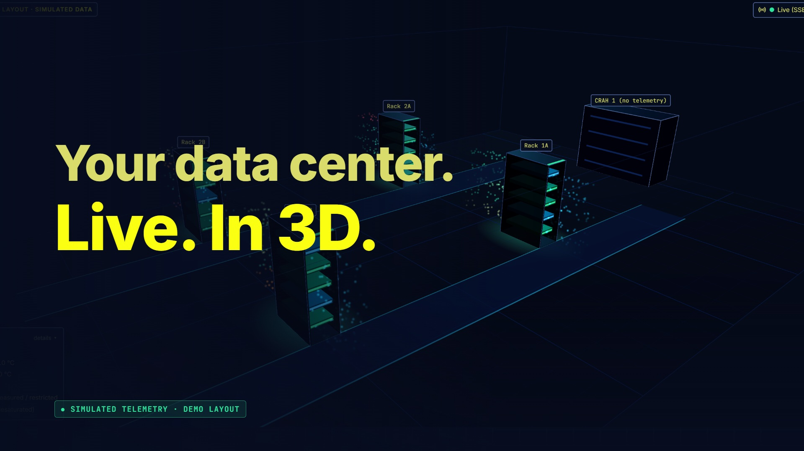
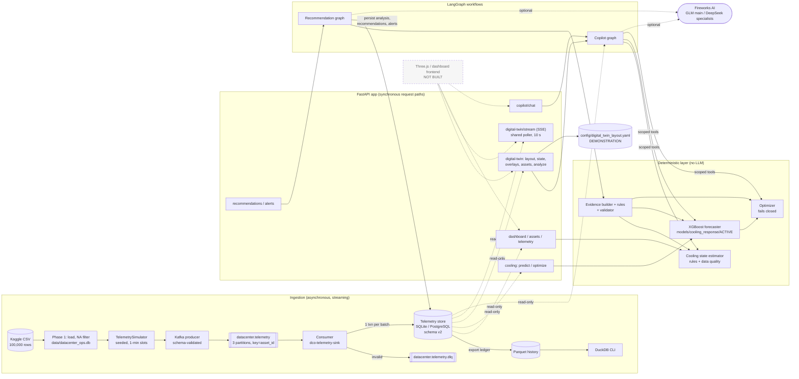
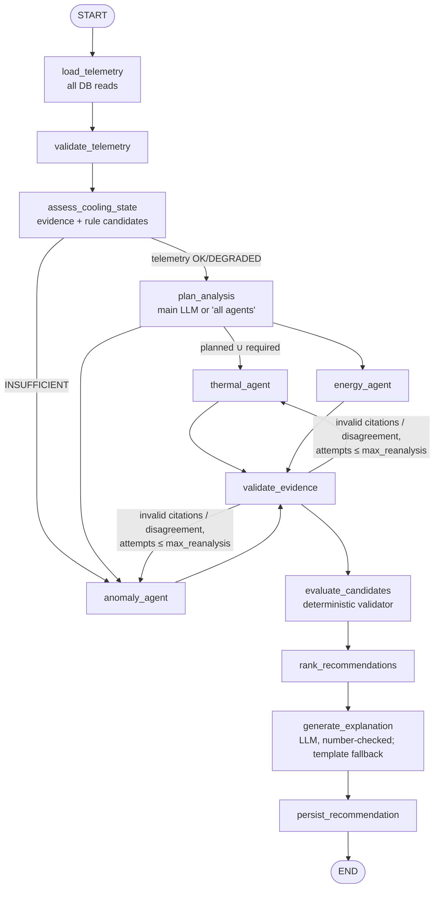

# ThermaCore: AI for Intelligent Data Center Operations

<p align="center">
  <a href="brag-output/brag.mp4">
    
  </a>
  <br />
  <sub>▶ <a href="brag-output/brag.mp4">Watch the 22-second launch video</a> · simulated telemetry · demonstration layout</sub>
</p>

AMD ACT III Hackathon project. ThermaCore ingests data center telemetry through Apache Kafka, stores it
idempotently, assesses the thermal and cooling state of every server with deterministic rules, forecasts
inlet temperature with XGBoost, and lets operators investigate through a LangGraph multi-agent
recommendation workflow, a natural-language copilot and a digital-twin API built for a Three.js frontend.

> **Read this first.**
> - **All telemetry is simulated.** The source Kaggle dataset describes itself as an *engineered synthetic
>   dataset* with no timestamps and no equipment IDs. Every event is generated from it and labelled
>   `source_type: "simulated"`. Nothing here is real operational telemetry.
> - **Recommendation-only.** No endpoint, agent or tool can command fans, chillers or setpoints.
> - **Backend only.** The repository has no frontend and no Three.js code. The digital twin is a backend
>   (layout, state, overlays, SSE) with a documented contract for a future Three.js client.
> - **The optimizer returns `UNAVAILABLE` on this data, by design.** The telemetry contains no cooling-system
>   power and no fan→inlet response, so no energy saving can be claimed or computed. Energy waste is
>   screened only as a **relative** indicator: fan speed against comparable peers, never in kW ([§14](#14-cooling-optimization-and-safety)).

---

## Documentation map

| Document | What it covers |
|---|---|
| **README.md** (this file) | Overview, status, architecture, data flows, setup, configuration, API summary |
| [docs/ARCHITECTURE.md](docs/ARCHITECTURE.md) | Component boundaries, detailed data flows, database model (ER), dataset and data quality, architecture decision records |
| [docs/API.md](docs/API.md) | Every implemented endpoint: parameters, validation, responses, errors, side effects, `curl` examples |
| [docs/ML_AND_OPTIMIZATION.md](docs/ML_AND_OPTIMIZATION.md) | XGBoost features, split, evaluation, artifacts, validity check, optimizer formulation and safety |
| [docs/AGENT_ARCHITECTURE.md](docs/AGENT_ARCHITECTURE.md) | LangGraph recommendation workflow, copilot graph, tools, validation, Fireworks integration |
| [docs/DIGITAL_TWIN.md](docs/DIGITAL_TWIN.md) | Layout model, identity mapping, state, overlays, SSE, Three.js integration and scaling |
| [docs/PRODUCTION_READINESS.md](docs/PRODUCTION_READINESS.md) | Reliability, security, observability, testing strategy, deployment, scaling, performance, prioritized gap analysis |
| [docs/PIPELINE_GUIDE.md](docs/PIPELINE_GUIDE.md) | Operating guide: Kafka producer, consumer, DLQ, Parquet, DuckDB, the cooling state estimator rules |
| [docs/cooling_model_report.md](docs/cooling_model_report.md) | Measured results of the active model artifact (source of truth for model numbers) |
| [docs/frontend_integration.md](docs/frontend_integration.md) | Contract for a future dashboard/copilot/Three.js frontend |
| [docs/dataset/README.md](docs/dataset/README.md) | What the Kaggle dataset contains, inspected column by column |

---

## Contents

1. [Project overview](#1-project-overview)
2. [Problem statement and motivation](#2-problem-statement-and-motivation)
3. [Features and implementation status](#3-features-and-implementation-status)
4. [Technology stack](#4-technology-stack)
5. [System architecture](#5-system-architecture)
6. [End-to-end data flows](#6-end-to-end-data-flows)
7. [Repository structure](#7-repository-structure)
8. [Prerequisites and local setup](#8-prerequisites-and-local-setup)
9. [Configuration reference](#9-configuration-reference)
10. [API reference (summary)](#10-api-reference-summary)
11. [Database and data model](#11-database-and-data-model)
12. [Dataset and data quality](#12-dataset-and-data-quality)
13. [XGBoost model and forecasting](#13-xgboost-model-and-forecasting)
14. [Cooling optimization and safety](#14-cooling-optimization-and-safety)
15. [LangGraph and multi-agent architecture](#15-langgraph-and-multi-agent-architecture)
16. [Digital twin](#16-digital-twin)
17. [Natural-language operations copilot](#17-natural-language-operations-copilot)
18. [Reliability, security and observability](#18-reliability-security-and-observability)
19. [Testing and evaluation](#19-testing-and-evaluation)
20. [Deployment and scaling](#20-deployment-and-scaling)
21. [Performance and cost engineering](#21-performance-and-cost-engineering)
22. [Architectural decisions and trade-offs](#22-architectural-decisions-and-trade-offs)

---

## 1. Project overview

### What ThermaCore does

ThermaCore is an operations-intelligence backend for one hypothetical North American data center
(`dc-na-sim-001`) with 20 simulated servers (`SIM-NA-001` … `SIM-NA-020` in the default run).

1. **Telemetry.** A seeded simulator turns rows of the Kaggle dataset into one JSON event per server per
   simulated minute. It publishes them to the Kafka topic `datacenter.telemetry`.
2. **Ingestion.** A Kafka consumer validates every event against a versioned JSON Schema, stores it
   idempotently in SQLite or PostgreSQL, sends bad messages to a dead-letter topic, and exports Parquet
   history for DuckDB analytics.
3. **Assessment.** The Cooling State Estimator, a deterministic rule engine, classifies each server and the
   whole data center into states such as `HIGH_THERMAL_LOAD`, `APPROACHING_THERMAL_LIMIT` or
   `DATA_QUALITY_ISSUE`, with evidence for each finding.
4. **Forecasting.** Two XGBoost models predict inlet temperature 5 and 10 minutes ahead under the observed
   operating conditions.
5. **Optimization.** A constrained, recommendation-only optimizer is implemented. It refuses to evaluate
   hypothetical settings unless the model passes an intervention-validity check, and it refuses to rank
   settings by energy without measured cooling power. On this data it returns `UNAVAILABLE`.
6. **Investigation.** A LangGraph workflow builds typed evidence deterministically. Specialist LLM agents
   on Fireworks AI interpret it, and a plain-Python validator decides what becomes a recommendation for
   human review. An operations copilot answers natural-language questions with read-only tools.
7. **Digital twin API.** Facility layout with coordinates, per-server live state, overlays, an inspection
   panel and Server-Sent Events, for a Three.js client that is not part of this repository.

### Monitoring, forecasting, optimization and autonomous control

| Capability | Question it answers | Status here |
|---|---|---|
| Monitoring | What is happening now, and how reliable is the data? | Implemented: estimator, dashboard, assets, twin state |
| Forecasting | What will inlet temperature be in 5/10 min if nothing changes? | Implemented as a `forecasting_baseline`; it does not beat persistence on the test split |
| Optimization | Which setting minimizes cooling energy while staying safe? | Implemented logic, **blocked by missing data**: returns `UNAVAILABLE` with reasons |
| Energy-waste screening | Which fans run faster than comparable peers under similar conditions? | Implemented, **relative only** (no kW); most assets lack comparable peers |
| Autonomous control | Apply the setting to the equipment | **Not implemented, deliberately.** No actuation path exists |

### Who uses it and how

- **Operators**: dashboard overview, per-asset history, cooling state, alerts, copilot questions,
  review decisions on recommendations (`APPROVED_FOR_EVALUATION`, `REJECTED`, `DEFERRED`).
- **Reliability and facilities engineers**: recommendation evidence, execution traces, data-quality
  findings, model evaluation and validity reports.
- **Frontend developers**: the digital twin and dashboard contracts in
  [docs/frontend_integration.md](docs/frontend_integration.md).

### Summary for a recruiter or engineering manager

ThermaCore is a Python/FastAPI backend that streams simulated server telemetry through Kafka into an
idempotent SQL store, evaluates thermal risk with deterministic rules, forecasts inlet temperature with
XGBoost, and wraps it all in LangGraph agent workflows on Fireworks AI. The validator, not the LLM,
controls every number and every recommendation. Its distinguishing engineering choice is that it **fails
closed**: it reports clearly what the data cannot support (cooling energy, causal fan effects, real topology)
instead of presenting synthetic correlations as savings. The test suite has 451 passing unit and API tests.

### Status and the most important limitations

- Implemented and tested: ingestion, storage, estimator, forecaster, optimizer logic, recommendation
  workflow, copilot, digital twin backend, 29 API routes.
- Not built: frontend, anomaly detector (only simulator-injected labels exist), any equipment control,
  CI/CD, container image for the API, metrics/tracing.
- Data limits: synthetic telemetry; no cooling power, setpoints, cooling efficiency or facility power;
  no rack/room topology (the twin layout is a labelled demonstration).
- Model limits: pooled RMSE skill against persistence is −4.0 % at 5 min and −1.4 % at 10 min (the model is
  slightly *worse* than "no change"). See [docs/cooling_model_report.md](docs/cooling_model_report.md).

---

## 2. Problem statement and motivation

### The operational problem

A data center must remove the heat that its IT equipment produces, continuously, without letting server
inlet air exceed the equipment's allowed envelope. ASHRAE TC 9.9 gives a *recommended* inlet range of
18–27 °C for common equipment classes. Cooling capacity is usually provisioned and controlled with fixed
policies: constant fan speeds, conservative setpoints, schedules. A fixed policy has to be sized for the
worst case. When workload is light, it keeps removing heat that isn't there and spends fan and chiller
energy for nothing. When workload rises quickly, a fixed policy reacts late.

### Why "just minimize fan speed" is wrong

Minimizing fan speed or cooling power alone is an unconstrained objective with a known bad optimum: zero
cooling. The real problem is constrained:

- **Safety constraint.** Inlet temperature must stay below a verified limit with margin, at every
  forecast horizon, including the uncertainty of the forecast.
- **Workload coupling.** Heat load follows compute load. A setting that is safe at 30 % CPU can be unsafe
  at 90 %, so any recommendation is conditional on workload staying in the regime it was evaluated in.
- **Equipment constraints.** Actuators have bounds, rate limits and minimum airflow requirements.
- **Causality.** To claim that a lower fan speed is safe, you need to know how temperature *responds to
  the fan*, not how temperature and fan speed co-varied historically.

### Kinds of power, and what this dataset measures

| Quantity | Meaning | In this telemetry? |
|---|---|---|
| Server (IT) power | Electrical power drawn by the server | **Yes**: `power_consumption_kw`, per server |
| Cooling-system power | Fans, CRAH/CRAC units, chillers, pumps, cooling towers | **No** |
| Facility power | Everything behind the utility meter: IT, cooling, UPS losses, lighting | **No** |
| Total facility energy | Facility power integrated over time | **No** |
| PUE | Facility energy ÷ IT energy | A per-asset `pue` value is carried in the simulated telemetry. It is **not** a measured facility ratio |

Server power is **not** a proxy for cooling power. It mostly follows compute load. Lowering a fan may
raise server power slightly (leakage current rises with temperature) while it lowers cooling power, so
using IT power as the objective could reward exactly the wrong action. ThermaCore therefore never labels
`power_consumption_kw` as cooling power, and the optimizer's energy objective stays unset
(`optimizer.energy_objective.measured_cooling_power_column: null`).

### Thermal anomalies, maintenance and stale data

- Airflow degradation (clogged filters, failed fans, obstructions) shows up as falling airflow with rising
  temperature, or as fan speed rising while airflow does not. The estimator has rules for both
  (`AF_AIRFLOW_DROP_WITH_RISING_TEMPERATURE`, `AF_FAN_AIRFLOW_DIVERGENCE`). They are labelled *potential*
  issues, not confirmed faults.
- **Stale or missing data is a safety problem, not just a quality problem.** A reading from 20 minutes ago
  that says 22 °C is not evidence that the inlet is 22 °C now. Treating a missing value as 0 would make a
  dead sensor look like a cold server. ThermaCore keeps missing readings as explicit nulls, checks
  freshness on two clocks (event time and wall-clock ingest time), and downgrades or blocks conclusions
  when data is stale (see [§18](#18-reliability-security-and-observability)).

### Why recommendations need evidence and explicit constraints

An operator can only act on a recommendation they can check. Every recommendation here carries typed
evidence items (`measured`, `derived`, `model_prediction`, `rule_finding`, `configuration`,
`unavailable`) with stable IDs, the constraints that were checked, the missing evidence, the
conditions that invalidate it, an uncertainty level with its basis, and `human_approval_required: true`.

---

## 3. Features and implementation status

Status legend: **Implemented** (code + tests), **Partial** (works with stated gaps), **Prototype**
(demonstration-grade), **Unavailable** (logic exists, blocked by missing data), **Planned/Not built**.

| Feature | What it does | Implementation | Status | Important limitations |
|---|---|---|---|---|
| Dataset ingestion | Kaggle download, checksum manifest, load 100,000 rows into SQLite, NA filter | `src/data_engineering/ingestion/`, `processing/filter_region.py` | Implemented | Source is self-described synthetic |
| Telemetry simulation | Seeded 1-minute series per asset, missing slots, injected anomalies (labelled) | `simulation/generate_telemetry.py`, `config/simulation.yaml` | Implemented | Inlet depends on workload only, never on fan speed |
| Kafka producer | Schema-validated JSON events, key = `asset_id`, delivery tracking, pacing | `streaming/producer.py`, `events.py`, `telemetry_event.v1.schema.json` | Implemented | Single local broker, RF 1, no TLS/auth |
| Kafka consumer + DLQ | Validate, batch transaction, idempotent on `event_id`, DLQ, safe offset commits | `streaming/consumer.py`, `event_validation.py`, `dead_letter.py` | Implemented | One consumer process tested per group |
| Telemetry store | SQLite (default) or PostgreSQL, same SQL, schema v2 | `storage/`, `db/telemetry_store_{sqlite,postgres}.sql` | Implemented | No retention/pruning; no migration framework |
| Parquet history + DuckDB | Ledgered, crash-safe export; SQL over Parquet in place | `storage/parquet_sink.py`, `analytics/` | Implemented | Not exposed over HTTP (CLI only) |
| Cooling state estimator | Rules over a rolling window per asset; states, findings, evidence, DQ | `src/data_engineering/cooling/`, `config/cooling_state.yaml` | Implemented | Most limits unset by design → `PARTIALLY_ASSESSED` |
| Dashboard and analytics API | KPIs, freshness, thermal risk, trends, anomaly labels, alerts | `src/app/dashboard/` | Implemented (API) | No dashboard UI |
| Asset and historical telemetry API | Asset list/detail, raw or bucketed history, keyset cursor | `src/app/assets/`, `src/data_engineering/telemetry_query.py` | Implemented | Max 24 h range and 5,000 points per request (configurable) |
| XGBoost thermal forecasting | Inlet forecast at +5/+10 min; versioned artifacts | `src/data_engineering/cooling_model/`, `src/app/cooling/` | Implemented, **baseline quality** | Does not beat persistence pooled; simulated data only |
| Cooling optimization | Grid/candidate evaluation under T_safe, bounds, support range | `cooling_model/optimizer.py` | **Unavailable** on this data | No validated response, no cooling power, T_safe/bounds unset |
| Energy-waste screening | Fan over-speed vs comparable peers (same cooling and asset type, matched workload and inlet); affinity-law relative fan power | `src/data_engineering/energy/fan_peer.py`, `GET /energy/fan-peer-comparison`, `ENERGY_WASTE` rule | Implemented, **relative only** | No kW or savings (no cooling power); association, not causation; 13 of 20 assets lack comparable peers at 14:00 |
| Recommendation generation | LangGraph workflow, 6 recommendation types, validator, persistence, human decisions | `src/data_engineering/recommendations/`, `src/app/recommendations/` | Implemented | On current data almost all results are `INCONCLUSIVE` or not applicable; the exception is `ENERGY_WASTE` for SIM-NA-016 at 14:00 (`REQUIRES_REVIEW`, relative only) |
| Alerts | WARNING/CRITICAL findings persisted **when an analysis runs** | `recommendations/graph.py: alert_rows`, `GET /alerts` | Partial | No continuous alerting; created only by `POST /recommendations/generate` |
| Anomaly and maintenance analysis | Airflow rules, persistence across windows, history z-scores, maintenance triage | `cooling/rules.py`, `recommendations/evidence.py`, `copilot/tools.py` | Partial | No statistical anomaly **detector**; only rules + injected labels |
| LangGraph orchestration | Two compiled `StateGraph`s with conditional routing and parallel fan-out | `recommendations/graph.py`, `copilot/graph.py` | Implemented | No checkpointer (no resumable runs) |
| Operations copilot | Intent parsing, scoped read-only tools, number-checked answers, bounded memory | `src/data_engineering/copilot/`, `POST /copilot/chat` | Implemented | Keyword parser; in-process memory; topology words force a clarification |
| Digital twin backend | Layout, state, overlays, inspection, analyze, SSE | `src/app/digital_twin/`, `src/data_engineering/digital_twin/layout.py` | Implemented (API) | Demonstration layout; no CFD; no airflow direction |
| Three.js digital twin UI | 3D rendering, object picking | — | **Not built** | Contract only: [docs/frontend_integration.md](docs/frontend_integration.md) |
| Spatial overlays | 9 overlay types with visual bands | `TwinService.overlays` | Implemented (API) | Bands are visual, not safety limits; `cooling_efficiency` always `UNAVAILABLE` |
| Live state updates | One shared poller → diff → SSE fan-out with replay buffer | `src/app/digital_twin/stream.py` | Implemented | In-process; event IDs reset on restart; not multi-replica |
| Access control | Opt-in static bearer token; asset scope | `src/app/common/security/auth.py` | Partial | One shared token; no users, roles or tenants |
| Observability | JSON logs, request IDs, run summaries, agent traces with tokens/latency | `logging_utils.py`, `middleware.py`, `recommendation_analyses.trace_json` | Partial | No metrics endpoint, no tracing, no log rotation |
| Evaluation | Offline forecast metrics vs persistence, segments, validity check | `cooling_model/evaluation.py`, `validity.py` | Partial | No agent-quality or energy-savings evaluation |
| Equipment control | — | — | **Not built (deliberately)** | Requires safety review; see [§14](#14-cooling-optimization-and-safety) |

---

## 4. Technology stack

Every entry below is verified in `pyproject.toml` and imported by project code.

| Technology | Why | Owns | Does not own | Reasonable alternatives | Worth replacing? |
|---|---|---|---|---|---|
| **Python 3.13 + uv** | One language for data, ML, API and agents; uv gives a locked, reproducible environment (`uv.lock`) | Runtime, dependency resolution | — | Poetry, pip-tools | No: uv is fast and already locked |
| **FastAPI + Uvicorn** | Typed request validation (Pydantic), OpenAPI at `/docs`, sync handlers in a threadpool, SSE via `StreamingResponse` | HTTP layer, validation, error rendering | Business logic (lives in `data_engineering`) | Flask, Django REST, Litestar | No. Revisit only for very high fan-out SSE |
| **Pydantic v2 / pydantic-settings** | Strict schemas (`extra="forbid"`), env-based settings | API contracts, LLM output schemas, settings | Persistence | attrs + marshmallow | No |
| **Apache Kafka 3.9.1 (KRaft, Docker)** | Durable, replayable, partitioned log between producer and consumers | Transport and retention (7 days) | Transformation, deduplication, system of record | Redpanda, Pulsar, Kinesis, direct DB writes | Redpanda is a drop-in local option; the design doesn't depend on Kafka-only features |
| **confluent-kafka (librdkafka)** | Idempotent producer, delivery callbacks, AdminClient, Windows wheels | Client protocol | — | kafka-python, aiokafka | No |
| **jsonschema** | One event contract (`telemetry_event.v1.schema.json`) validated by producer and consumer | Event validation | Schema evolution tooling | Schema Registry + Avro/Protobuf | Yes at scale, for compatibility enforcement |
| **SQLite / PostgreSQL 16 (psycopg 3)** | SQLite needs nothing locally; PostgreSQL for concurrency. One hand-written SQL layer serves both | System of record for telemetry, recommendations, decisions, alerts | Long-horizon analytics | TimescaleDB, ClickHouse, InfluxDB | TimescaleDB is the natural next step (partitioning, retention, continuous aggregates) |
| **PyArrow + Parquet, DuckDB** | Columnar, compressed, immutable history; SQL in place without loading | Historical analytics (CLI) | Transactions, serving the API | Spark, ClickHouse | Not at this scale |
| **XGBoost 3.x (native API) + NumPy** | Strong on tabular lag features, handles NaN natively, fast CPU training, portable `.ubj` artifacts | Inlet forecasting | Causal/intervention estimates | LightGBM, linear AR models, LSTM/TFT | No evidence a deep model would help: the target is near-unpredictable noise by construction |
| **LangGraph** | Explicit state graphs: conditional edges, parallel fan-out (`Send`), bounded loops (re-analysis), per-node traces | Orchestration of the two agent workflows | Numbers, rules, validation, persistence | Plain function pipeline, CrewAI, AutoGen | Possibly. A plain pipeline would also work; see ADR in [§22](#22-architectural-decisions-and-trade-offs) |
| **LangChain (`langchain-fireworks`, `langchain-core`)** | `ChatFireworks.with_structured_output(method="function_calling")` for schema-bound tool calls with usage metadata | LLM client and structured output | Prompts' safety | Fireworks OpenAI-compatible SDK directly | Low value either way; it's a thin adapter (`recommendations/llm.py`) |
| **Fireworks AI** | Hosted open models: `glm-5p3-flash` (main: planning, explanation) and `deepseek-v4p1-flash` (specialists) | LLM inference | Any decision that matters for safety | Other hosted APIs, self-hosted vLLM | Configurable through env vars; nothing is provider-specific beyond the adapter |
| **Docker Compose** | Local Kafka broker and optional PostgreSQL | Local infrastructure | Deploying the API | — | — |
| **pytest + httpx** | Unit, API (ASGI transport with the real lifespan), PostgreSQL-marked and Kafka-integration tests | Test harness | — | — | No |

**Not used** (despite appearing in early designs): React/Next.js, Three.js, Redis, Prometheus,
OpenTelemetry, an ORM, a vector store/RAG.

---

## 5. System architecture



Solid arrows are implemented calls; dotted arrows are read-only store access or optional LLM calls; the
dashed node is not implemented. Streaming happens only between the producer, Kafka and the consumer, and
from the API to browsers over SSE. Every API request path is synchronous; LLM calls happen inside the
request (`POST /recommendations/generate` can take tens of seconds with LLMs enabled).

### Components and boundaries

| Component | Responsibility | Boundary (what it never does) |
|---|---|---|
| Simulator + producer (`streaming/producer.py`) | Generate events, validate, publish with key `asset_id` | Never writes the store |
| Kafka | Durable buffer, replay, fan-out | Not the system of record; no dedup; no validation |
| Consumer (`streaming/consumer.py`) | Validate, persist batches, DLQ, commit offsets only after durability | No analytics |
| Telemetry store (`storage/base.py`) | System of record; parameterized SQL only | No business rules |
| Estimator (`cooling/estimator.py`) | Deterministic state + findings + data quality | Never optimizes or calls an LLM |
| Forecaster (`cooling_model/predictor.py`) | Forecast under observed conditions | Never evaluates hypothetical settings unless `intervention_validated` |
| Optimizer (`cooling_model/optimizer.py`) | Feasibility under T_safe/bounds/support | Never actuates (`recommendation_only` cannot be disabled) |
| Recommendation graph (`recommendations/graph.py`) | Orchestrate evidence → agents → validator → persistence | Agents never query data or emit numbers |
| Copilot graph (`copilot/graph.py`) | Question → scoped read-only tools → validated answer | No SQL from the LLM; no write tools |
| Digital twin (`app/digital_twin/`) | Join layout with state, overlays, SSE | Not a physics simulation; layout is illustrative |
| API (`app/`) | Validation, auth, scope, error contract, lifecycle | Domain logic stays in `data_engineering` |

### Sources of truth

| Data | Source of truth | Notes |
|---|---|---|
| Telemetry | `telemetry_readings` in the telemetry store | Kafka is transport; Parquet is derived from the store |
| Asset identity | `assets` keyed by `(simulation_run_id, asset_id)` | IDs repeat across runs, so every query is run-scoped |
| Facility layout | `config/digital_twin_layout.yaml` | Maps `srv-013` → `SIM-NA-013`; demonstration only |
| Thresholds and constraints | `config/cooling_state.yaml` (limits), `config/cooling_model.yaml` (`optimizer.*`) | Unset values are `null` and disable the dependent rule |
| Predictions | The `ACTIVE` artifact in `models/cooling_response/` | Computed on request; not stored |
| Recommendations, decisions, alerts | `recommendations`, `recommendation_decisions`, `alerts` tables | Written only by the recommendation workflow and the decision endpoint |
| Conversation context | In-process `ConversationStore` | Lost on restart, by design |

Details: [docs/ARCHITECTURE.md](docs/ARCHITECTURE.md).

---

## 6. End-to-end data flows

Each flow is summarized here and traced function by function in
[docs/ARCHITECTURE.md §2](docs/ARCHITECTURE.md#2-end-to-end-data-flows).

**A. Telemetry ingestion.** `producer.py simulate` builds an event per (asset, slot) in
`events.build_event` and validates it against `telemetry_event.v1.schema.json`. It publishes with
`acks=all` and idempotence on. Event time is simulated (`start + slot_index × 60 s`); the Kafka record
timestamp stays publish time, so retention works. The consumer polls up to 1,000 messages or 2 s, validates
each one (`event_validation.py`), and writes the batch in one transaction (`SqlTelemetryStore.persist_batch`).
Inserts are idempotent on `event_id`; a duplicate with different content is counted as `rows_conflicting`,
and the first version wins. Invalid messages go to the DLQ with a reason code. Offsets are committed only
after the DB commit and DLQ confirmation, and only up to the contiguous handled prefix. Missing readings
are stored as `reading_status='missing'` with NULL metrics, never zeros. Readings are queryable through
the API as soon as the batch commits.

**B. Dashboard query.** `GET /dashboard/overview` → `DashboardService.overview`. It resolves the run (default:
the run whose assets were updated most recently), applies the operator scope, and gets each asset's latest
*observed* reading with one aggregate query (`store.latest_observed`). It computes KPIs across assets,
freshness (event time, `stale_after_seconds`) and pipeline staleness (wall clock,
`max_ingest_age_seconds`). It then runs the estimator for thermal risk and builds per-asset 5-minute
trend buckets. An empty run gives `404 unknown_run`; stale data gives `warnings`, not errors.

**C. Thermal prediction.** `POST /cooling/predict` → `CoolingModelService.predict_v2`. It checks availability
(model loaded, feature config unchanged, optional max age), then calls `CoolingResponseModel.predict_for_asset`.
That reads the last 16 minutes of readings (`lookback_minutes + 1`) and builds features with the same code as
training (`features.build_features`). The two boosters predict the inlet **change**, and the response returns
`inlet(t) + Δ̂` next to persistence and the offline RMSE.

**D. Cooling optimization.** `POST /cooling-optimizer/recommend` or `/cooling/optimize` →
`optimizer.recommend`. It first forecasts under current conditions, then collects blocking reasons:
`RESPONSE_MODEL_NOT_VALIDATED`, `ENERGY_OBJECTIVE_MISSING`, `T_SAFE_NOT_CONFIGURED`,
`ACTUATOR_BOUNDS_NOT_CONFIGURED`. With any blocking reason the status is `UNAVAILABLE` and candidates are
listed as not evaluated. With all constraints present the best possible status is `CONSTRAINTS_ONLY`, because
no energy model exists.

**E. Multi-agent investigation.** `POST /recommendations/generate` → `RecommendationEngine.analyze` → compiled
`StateGraph`: `load_telemetry` (all DB reads) → `validate_telemetry` → `assess_cooling_state` (evidence +
deterministic rule candidates) → `plan_analysis` (main LLM) → specialist agents in parallel →
`validate_evidence` (bounded re-analysis) → `evaluate_candidates` (validator) → `rank_recommendations` →
`generate_explanation` (LLM, number-checked, template fallback) → `persist_recommendation`.

**F. Digital twin interaction.** The client loads `GET /digital-twin/layout` and builds meshes keyed by `id`,
with `asset_id` in `userData`. It fetches `GET /digital-twin/state`, colours with `GET /digital-twin/overlays`,
subscribes to `GET /digital-twin/stream`, and on click calls `GET /digital-twin/assets/{object_id}` and
`POST /digital-twin/analyze`. Identity is resolved by layout `id`, never by mesh position.

**G. Recommendation lifecycle.** Evidence (deterministic) → rule candidate (`rules.py`) → agent finding
(optional LLM) → validator status `REQUIRES_REVIEW` or `INCONCLUSIVE` → persisted with a deterministic ID
`rec-sha256(run|asset|type|window_end)[:20]` (deduplicated) → listed (`GET /recommendations`) → human
decision appended (`POST /recommendations/{id}/decisions`). The latest decision is the review status
(`PENDING_REVIEW` if none). There is no "resolved" state and no execution step.

---

## 7. Repository structure

```
.
├── README.md                         this file
├── CLAUDE.md                         project rules for AI-assisted development
├── pyproject.toml / uv.lock          dependencies (uv); requirements.txt is exported from the lock
├── docker-compose.yml                Kafka 3.9.1 (KRaft) on 127.0.0.1:9092; optional `postgres` profile on :55432
├── .env.example                      every environment variable with its default (no secrets)
├── config/
│   ├── simulation.yaml               simulator: seed, start, 1,440 slots, workload, noise, anomaly injection
│   ├── cooling_state.yaml            estimator window, data-quality tolerances, limits (5 reference values, rest null)
│   ├── cooling_model.yaml            XGBoost features/params/split, validity check, optimizer constraints (null)
│   ├── recommendations.yaml          agent workflow heuristics (history windows, persistence, re-analysis)
│   └── digital_twin_layout.yaml      DEMONSTRATION facility layout: room, aisles, racks, 20 servers, 2 CRAH
├── db/
│   ├── schema.sql / init_db.py       Phase 1 database (data/datacenter_ops.db)
│   └── telemetry_store_{sqlite,postgres}.sql, init_telemetry_store.py   telemetry store, schema v2
├── docs/                             see the documentation map above
├── models/cooling_response/          trained artifacts (committed, ~1.2 MB): <version>/model_h5.ubj, model_h10.ubj, metadata.json; ACTIVE
├── src/
│   ├── data_engineering/             pipeline, analytics, ML, agents (no HTTP)
│   │   ├── ingestion/                download_dataset.py (Kaggle + MANIFEST), load_source.py
│   │   ├── processing/               filter_region.py (NA subset)
│   │   ├── simulation/               generate_telemetry.py (TelemetrySimulator, METRICS)
│   │   ├── validation/               validate_dataset.py (Phase 1 checks → data/processed/validation_report.md)
│   │   ├── streaming/                producer, consumer, event schema, DLQ, settings, topic_setup, inspect_stream
│   │   ├── storage/                  base.py (shared SQL, idempotency, export ledger, read queries), sqlite/postgres stores, parquet_sink
│   │   ├── analytics/                duckdb_queries.py, query_telemetry.py (CLI)
│   │   ├── cooling/                  estimator.py, rules.py, metrics.py, models.py (CoolingStateSnapshot), config.py
│   │   ├── cooling_model/            features, dataset, training, evaluation, validity, artifacts, predictor, optimizer, config
│   │   ├── recommendations/          graph.py (LangGraph), evidence.py, rules.py, validator.py, specialists.py, llm.py, schemas.py, cli.py
│   │   ├── copilot/                  graph.py (LangGraph), understanding.py, tools.py, memory.py, schemas.py
│   │   ├── digital_twin/layout.py    layout parsing/validation/versioning, LayoutProvider (reload on change)
│   │   ├── telemetry_query.py        shared read-only query helpers, units, aggregation semantics
│   │   └── pipeline.py, db.py, config.py, paths.py, logging_utils.py
│   └── app/                          FastAPI package
│       ├── main.py                   create_app() + lifespan (the only entry point: app.main:app)
│       ├── config.py                 AppSettings (API_* variables)
│       ├── database.py               StoreFactory, get_db_session, get_read_session
│       ├── middleware.py             request ID + access log, security headers, CORS
│       ├── exceptions.py             AppError hierarchy → {"error": {...}, "request_id"}
│       ├── api/v1/router.py          /health + mounts every domain behind require_operator
│       ├── common/                   schemas (CustomModel, UtcDatetime), security (auth, headers), pagination, logging
│       ├── telemetry/                GET /telemetry/cooling-state
│       ├── dashboard/                GET /dashboard/overview
│       ├── assets/                   GET /telemetry, /assets, /assets/{id}, /assets/{id}/telemetry
│       ├── cooling/                  /cooling-model/*, /cooling-optimizer/recommend, /cooling/{predict,optimize}
│       ├── recommendations/          /recommendations/*, /alerts/*
│       ├── copilot/                  POST /copilot/chat (+ build_copilot)
│       └── digital_twin/             /digital-twin/* and the SSE broadcaster (stream.py)
└── tests/                            unit, API, security, PostgreSQL-marked and Kafka integration tests (+ helpers and fakes)
```

Generated and gitignored: `data/` (raw download, SQLite databases, Parquet), `logs/`, `.env` and `graphify-out/`. The trained model artifacts in `models/` **are** committed.

---

## 8. Prerequisites and local setup

### What you need

| Requirement | Version / note | Check |
|---|---|---|
| OS | Developed and run on Windows 11 (Git Bash and PowerShell). Linux/macOS should work but were not run | — |
| Python | ≥ 3.13 (`requires-python`) | `python --version` |
| uv | Package manager | `uv --version` |
| Docker Desktop | Runs the Kafka broker (and optional PostgreSQL). **Required to populate the telemetry store**: the consumer is the only writer of telemetry | `docker compose version` |
| Disk | About 25 MB of raw data plus small databases; Parquet history is about 2 MB per 24 h run | — |
| Kaggle access | The public dataset downloads anonymously with Kaggle CLI 2.x. If asked, use `uv run kaggle auth login` or set `KAGGLE_API_TOKEN` | — |
| Fireworks API key | **Optional.** Without it every agent workflow runs deterministically | — |

### Works without any credentials vs. needs a provider key

| Without `FIREWORKS_API_KEY` | Needs `FIREWORKS_API_KEY` |
|---|---|
| Everything except LLM text: ingestion, store, estimator, dashboard, assets, forecasting, optimizer, twin, SSE, recommendations (`mode: deterministic`, template explanations), copilot (keyword parser, deterministic summary) | LLM planning, specialist interpretations, LLM explanations and copilot answers (`mode: llm`) |

### Step by step (dependency order matters)

Commands are for Git Bash; PowerShell differences are noted. Run them from the repository root.

```bash
# 1. Install dependencies into .venv (includes the dev group: pytest, httpx, psycopg)
uv sync
```
Expected: `.venv/` is created. Verify: `uv run python -c "import xgboost, langgraph, fastapi; print('ok')"`.

```bash
# 2. Optional: local settings (all defaults work without it). Never commit .env.
cp .env.example .env               # PowerShell: Copy-Item .env.example .env
```
To enable LLM agents, set `FIREWORKS_API_KEY=<your key>` in `.env`. Precedence is: CLI flag > real
environment variable > `.env` > built-in default.

```bash
# 3. Phase 1: download the dataset, load SQLite, filter NA rows, store a 24 h simulation, validate
uv run python -m data_engineering.pipeline
```
Expected: `data/raw/hyperscale-data-center-dataset/` with `MANIFEST.json`, `data/datacenter_ops.db`, and
`data/processed/validation_report.md`. Exit code 0 means validation passed. Re-running is idempotent. The
command takes no flags (`--help` runs the pipeline too).

```bash
# 4. Start Kafka and create the topics (idempotent)
docker compose up -d --wait kafka
uv run python -m data_engineering.streaming.topic_setup
```
Expected: `docker compose ps` shows `dco-kafka … (healthy)` and the topic tool prints
`topic datacenter.telemetry: created, 3 partitions` and the same for `datacenter.telemetry.dlq`
(`already existed` on later runs). Use `127.0.0.1`, not `localhost`, from the host (see
[PIPELINE_GUIDE §I](docs/PIPELINE_GUIDE.md#i-reliability-and-troubleshooting)).

```bash
# 5. Initialize the telemetry store (SQLite by default: data/telemetry_store.db, schema v2)
uv run python db/init_telemetry_store.py
```
Expected: `initialized sqlite:...telemetry_store.db (schema version 2)`. This must run before the
consumer and the API; otherwise they report `store_not_initialized`.

```bash
# 6. Publish the 24 h default run (20 assets × 1,440 minutes = 28,800 events), then consume it
uv run python -m data_engineering.streaming.producer simulate
uv run python -m data_engineering.streaming.consumer --idle-timeout-s 10
```
Expected: the producer prints `SUCCESS: attempted=28800 delivered=28800 …` (exit 0). The consumer stops
10 s after the last message. To keep it streaming, run the consumer without `--idle-timeout-s` in one
terminal and `producer simulate --continuous --speedup 60` in another (one simulated minute per second).

```bash
# 7. Optional: retrain the forecaster on your own store (a trained artifact is already committed in models/)
uv run python -m data_engineering.cooling_model.training
```
The committed artifact `crm-20261013T120438Z-1443761922fc8cc7` is loaded at startup, so this step is only
needed after changing data or `config/cooling_model.yaml` (a feature-config change makes `/cooling/*` report
`FEATURE_SCHEMA_MISMATCH` until you retrain). Retraining creates a new version directory. Expected: JSON with `version`, `model_label: "forecasting_baseline"`, test metrics, and the validity
reasons. `models/cooling_response/ACTIVE` names the new artifact. It needs at least one run of ≥ 60 minutes
and ≥ 2,000 training rows per horizon. If no artifact is present the API still starts; model endpoints return
`503 model_not_trained` or `status: UNAVAILABLE`.

```bash
# 8. Start the API
uv run uvicorn app.main:app --host 127.0.0.1 --port 8000
```
Verify:
```bash
curl http://127.0.0.1:8000/api/v1/health      # {"status":"ok","database":"sqlite","schema_version":2}
```
Interactive docs: http://127.0.0.1:8000/docs (disable with `API_DOCS_ENABLED=false`).

```bash
# 9. Tests (no broker needed)
uv run pytest
```

**Frontend:** there is none to start. See [docs/frontend_integration.md](docs/frontend_integration.md).

**Optional PostgreSQL:** set `POSTGRES_PASSWORD`, `TELEMETRY_DB_BACKEND=postgres` and
`TELEMETRY_POSTGRES_URL=postgresql://dco:<password>@127.0.0.1:55432/dco` in `.env`. Then run
`docker compose --profile postgres up -d --wait postgres` and repeat steps 5–8. Details:
[PIPELINE_GUIDE §II.10](docs/PIPELINE_GUIDE.md#ii10-setup-and-running).

### Troubleshooting setup

| Symptom | Cause / fix |
|---|---|
| `cannot reach Kafka at 127.0.0.1:9092` (exit 2) | Docker not running or broker unhealthy: `docker compose up -d --wait kafka` |
| `topic ... not found` | Run `topic_setup` (auto-creation is disabled on purpose) |
| API `503 store_not_initialized` | Run `db/init_telemetry_store.py` (the schema must be version 2) |
| API `404 unknown_run` | The store has no telemetry yet: run step 6 |
| `503 model_not_trained` / `status: UNAVAILABLE, MODEL_NOT_TRAINED` | Run step 7 |
| `MODEL_ARTIFACT_INVALID` | Artifact missing files, or trained with a different XGBoost major version: retrain |
| Recommendations take 10–60 s | LLM mode; set `AGENTS_LLM_ENABLED=false` for deterministic runs |
| Git Bash rewrites `/opt/kafka/bin/...` | Prefix `docker compose exec` commands with `MSYS_NO_PATHCONV=1` |

More: [PIPELINE_GUIDE §I and §II.14](docs/PIPELINE_GUIDE.md#ii14-troubleshooting).

---

## 9. Configuration reference

All variables can be set in the environment or in `.env`. Defaults below are the real defaults in code.

### API (`src/app/config.py`, prefix `API_`)

| Variable | Purpose | Default | Example | Sensitive |
|---|---|---|---|---|
| `API_ENVIRONMENT` | `development` / `test` / `production` (logged; no behaviour switch) | `development` | `production` | no |
| `API_DOCS_ENABLED` | Serve `/docs`, `/redoc`, `/openapi.json` | `true` | `false` | no |
| `API_DB_CONNECT_TIMEOUT_S` | PostgreSQL connect timeout per request (1–60) | `3` | `5` | no |
| `API_THREADPOOL_TOKENS` | Concurrent sync handlers (1–1000) | `40` | `80` | no |
| `API_CORS_ORIGINS` | JSON list of allowed origins; empty disables CORS. **Allows GET only** | `[]` | `["http://localhost:5173"]` | no |
| `API_MODEL_TRAINING_ENABLED` | Enable `POST /cooling-model/train` | `false` | `true` | no |
| `API_AUTH_TOKEN` | If set, every `/api/v1` route except `/health` needs `Authorization: Bearer <token>` | unset | `<random 32+ chars>` | **yes** |
| `API_ALLOWED_ASSETS` | Operator asset scope (JSON list); empty means all | `[]` | `["SIM-NA-001"]` | no |
| `API_QUERY_TIMEOUT_S` | Per-statement timeout for API reads (SQLite progress handler; PostgreSQL `statement_timeout`) | `10.0` | `5` | no |
| `API_MAX_TELEMETRY_RANGE_HOURS` | Widest time range per request (1–168) | `24` | `6` | no |
| `API_MAX_TELEMETRY_POINTS` | Points per response (10–50,000) | `5000` | `2000` | no |
| `API_DASHBOARD_TREND_MINUTES` | Default overview trend window; also the copilot's default window | `60` | `120` | no |
| `API_DASHBOARD_TREND_INTERVAL_MINUTES` | Trend bucket size | `5` | `15` | no |
| `API_MODEL_MAX_AGE_DAYS` | Artifacts older than this → predictions `UNAVAILABLE` (`MODEL_STALE`) | unset (not checked) | `30` | no |
| `API_TWIN_POLL_INTERVAL_S` | SSE shared poll interval | `10.0` | `5` | no |
| `API_TWIN_HEARTBEAT_S` | SSE heartbeat interval | `15.0` | `15` | no |
| `API_TWIN_MAX_SUBSCRIBERS` | SSE subscribers per process | `50` | `200` | no |
| `API_COPILOT_MAX_CONVERSATIONS` / `_MAX_TURNS` / `_CONVERSATION_TTL_S` | Bounded in-process copilot memory | `200` / `10` / `3600` | — | no |

### LLM provider (`src/data_engineering/recommendations/config.py: LLMSettings`, no prefix)

| Variable | Purpose | Default | Sensitive |
|---|---|---|---|
| `FIREWORKS_API_KEY` | Enables LLM mode. Server-side only; never logged or returned (`/agents/status` reports only whether it is set) | unset → deterministic | **yes** |
| `FIREWORKS_BASE_URL` | OpenAI-compatible base URL (the adapter strips a trailing `/v1` for ChatFireworks) | `https://api.fireworks.ai/inference/v1` | no |
| `FIREWORKS_MAIN_MODEL` | Planner, explainer, copilot planner/answer | `accounts/fireworks/models/glm-5p3-flash` | no |
| `FIREWORKS_SUBAGENT_MODEL` | Specialist agents | `accounts/fireworks/models/deepseek-v4p1-flash` | no |
| `FIREWORKS_TIMEOUT_S` | Per-call timeout (0–300) | `60.0` | no |
| `FIREWORKS_MAX_RETRIES` | Transport retries per call (0–5) | `1` | no |
| `FIREWORKS_MAX_TOKENS` | Output budget (256–32,768); both models reason before answering | `8192` | no |
| `FIREWORKS_REASONING_EFFORT` | `low` / `medium` / `high` | `low` | no |
| `AGENTS_LLM_ENABLED` | `false` forces deterministic workflows even with a key | `true` | no |

### Telemetry store, Kafka, Parquet (`src/data_engineering/streaming/settings.py`)

Shared by the consumer and the API, so both always point at the same store.

| Variable | Purpose | Default | Sensitive |
|---|---|---|---|
| `TELEMETRY_DB_BACKEND` | `sqlite` or `postgres` | `sqlite` | no |
| `TELEMETRY_SQLITE_PATH` | SQLite file | `data/telemetry_store.db` | no |
| `TELEMETRY_POSTGRES_URL` | PostgreSQL URL (logged with the password redacted) | unset | **yes** (contains the password) |
| `POSTGRES_USER` / `POSTGRES_DB` / `POSTGRES_PASSWORD` | Compose PostgreSQL container (no default password; it refuses to start without one) | `dco` / `dco` / — | password: **yes** |
| `TELEMETRY_TEST_POSTGRES_URL` | Enables `-m postgres` tests | unset | **yes** |
| `KAFKA_BOOTSTRAP_SERVERS`, `KAFKA_TOPIC`, `KAFKA_DLQ_TOPIC`, `KAFKA_GROUP_ID` | Broker and topics | `127.0.0.1:9092`, `datacenter.telemetry`, `datacenter.telemetry.dlq`, `dco-telemetry-sink` | no |
| `KAFKA_*` producer/consumer tuning, `CONSUMER_*`, `PARQUET_*`, `PRODUCER_*` | Delivery semantics, batching, retries, export thresholds | see `.env.example` (every one is listed with its default) | no |
| `LOG_LEVEL` | `DEBUG` / `INFO` / `WARNING` / `ERROR` | `INFO` | no |

### Configuration files and their overrides

| Variable | File | Consumed by |
|---|---|---|
| `COOLING_STATE_CONFIG` | `config/cooling_state.yaml` | Estimator; an invalid file **stops API startup** |
| `COOLING_MODEL_CONFIG` | `config/cooling_model.yaml` | Training, predictor, optimizer |
| `RECOMMENDATIONS_CONFIG` | `config/recommendations.yaml` | Recommendation workflow |
| `DIGITAL_TWIN_LAYOUT` | `config/digital_twin_layout.yaml` | Twin; reloaded when the file's mtime changes |
| `DATACENTER_OPS_DB_PATH` | `data/datacenter_ops.db` | Phase 1 and the producer's baseline rows |
| `KAGGLE_API_TOKEN` | — | Kaggle CLI, only if anonymous download is refused (**sensitive**) |

### Hardcoded values worth knowing

| Value | Where | Implication |
|---|---|---|
| ID pattern `^[A-Za-z0-9._:-]{1,64}$` | `app/telemetry/constants.py` | Asset/run IDs outside it are rejected with 422 |
| CORS `allow_methods=["GET"]` | `app/middleware.py` | A browser frontend cannot call the POST routes until this changes |
| SSE queue 100 events, replay buffer 500 | `TwinBroadcaster.__init__` | Slow clients receive `resync_required` |
| Copilot question ≤ 2,000 chars; LLM evidence ≤ 120 items | `copilot/graph.py` | Bounds prompt size |
| Graph recursion limits 40 / 30 | `RecommendationEngine.analyze`, `CopilotEngine.chat` | Bounds loops |
| Explanation re-asks: 2 attempts; LLM parse retries: 1 | `graph.py`, `llm.py` | Bounds LLM calls per analysis |
| Training feature sensitivity probe ±100 rpm | `training.py` | Reported association only, never used for decisions |
| SQLite `busy_timeout` 5 s, WAL, `synchronous=FULL` | `sqlite_store.py` | Writers wait up to 5 s for the lock |

---

## 10. API reference (summary)

Base URL `http://127.0.0.1:8000/api/v1`. All responses are JSON (SSE for `/digital-twin/stream`). The full
reference with request/response examples, validation rules and error codes is in
[docs/API.md](docs/API.md). The pre-v1 prefix `/api/...` still serves the same handlers as deprecated
aliases hidden from OpenAPI.

**Auth:** none unless `API_AUTH_TOKEN` is set; then every route except `/health` needs
`Authorization: Bearer <token>` (401 `unauthorized`). `API_ALLOWED_ASSETS` returns 403
`asset_not_authorized` for out-of-scope assets and hides them from lists.

**Errors:** every non-2xx response has the same shape, and the submitted input is never echoed:
```json
{"error": {"code": "unknown_asset", "message": "asset 'NOPE' not found in simulation run 'sim-...'", "details": null},
 "request_id": "41450fa8bec24571bfd1a8de27df8784"}
```

| Method | Path | Purpose | Writes? |
|---|---|---|---|
| GET | `/health` | Store reachability and schema version (no auth) | no |
| GET | `/dashboard/overview` | KPIs, freshness, thermal risk, trends, anomaly labels, alert counts | no |
| GET | `/telemetry/cooling-state` | Estimator snapshot (asset or data center) | no |
| GET | `/telemetry` | History for one or all assets, raw or `1m/5m/15m/1h` buckets | no |
| GET | `/assets`, `/assets/{asset_id}`, `/assets/{asset_id}/telemetry` | Asset list with freshness; detail with latest reading and cooling state; history | no |
| GET | `/cooling-model/evaluate` | Offline metrics and validity of the active model | no |
| GET | `/cooling-model/predict` | Forecast (503 when no model) | no |
| POST | `/cooling/predict` | Forecast with explicit `AVAILABLE`/`UNAVAILABLE` status and reasons | no |
| POST | `/cooling-optimizer/recommend` | Optimizer over the configured grid | no |
| POST | `/cooling/optimize` | Optimizer over operator-supplied candidates | no |
| GET | `/energy/fan-peer-comparison` | Fan over-speed vs comparable peers per asset (relative only, no kW) | no |
| POST | `/cooling-model/train` | Retrain + activate (403 unless enabled; 409 while running) | artifact files |
| POST | `/recommendations/generate` | Run the LangGraph workflow for one asset | analysis, recommendations, alerts |
| GET | `/recommendations`, `/recommendations/{id}`, `/recommendations/analyses/{id}`, `/recommendations/agents/status` | List (keyset cursor), detail with decisions, execution trace, configuration | no |
| POST | `/recommendations/{id}/decisions` | Record a human review decision | decision row |
| GET | `/alerts`, `/alerts/{alert_id}` | Alerts captured at generation time | no |
| POST | `/copilot/chat` | Natural-language question → validated answer with evidence | in-memory conversation only |
| GET | `/digital-twin/layout`, `/digital-twin/layout/{object_id}` | Hierarchy and coordinates | no |
| GET | `/digital-twin/state`, `/digital-twin/overlays` | Batch state; overlay values and bands | no |
| GET | `/digital-twin/assets/{object_id}` | Inspection panel | no |
| POST | `/digital-twin/analyze` | Copilot analysis of the selected object | in-memory conversation only |
| GET | `/digital-twin/stream` | SSE live updates | no |

```bash
curl "http://127.0.0.1:8000/api/v1/telemetry/cooling-state?asset_id=SIM-NA-013&run_id=sim-c9944cc35156"
curl -X POST http://127.0.0.1:8000/api/v1/cooling/predict -H "Content-Type: application/json" \
     -d '{"asset_id": "SIM-NA-013", "run_id": "sim-c9944cc35156"}'
curl -X POST http://127.0.0.1:8000/api/v1/copilot/chat -H "Content-Type: application/json" \
     -d '{"message": "What should we investigate first?"}'
```

Not implemented (no route exists): telemetry ingestion over HTTP, recommendation "resolve/close", alert
acknowledgement, DuckDB analytics over HTTP, any control endpoint. See
[docs/API.md §Planned](docs/API.md#planned-not-implemented).

---

## 11. Database and data model

Two separate SQLite files (or PostgreSQL for the second):

- **Phase 1 database** `data/datacenter_ops.db` (`db/schema.sql`): `source_records` (all 100,000 rows,
  `provenance='dataset'`), the NA subset, stored simulation runs, and injected-anomaly tables. The
  producer reads its baseline rows from here.
- **Telemetry store** `data/telemetry_store.db` or PostgreSQL (`db/telemetry_store_{sqlite,postgres}.sql`,
  schema version 2). It is the system of record served by the API.

| Table | Key | Role |
|---|---|---|
| `assets` | `(simulation_run_id, asset_id)` | Inventory per run, static attributes, provenance, `first/last_event_timestamp`, `updated_at` |
| `telemetry_readings` | `event_id` | One row per event: 16 typed metric columns, `reading_status`, raw + normalized timestamp, `payload_sha256`, Kafka coordinates |
| `anomaly_records` | `(anomaly_id, event_id)` | Simulator-injected labels only (`label_source='simulator_injected'`) |
| `ingestion_batches`, `parquet_exports` | `batch_id`, `export_id` | Consumer batch audit and the Parquet export ledger |
| `recommendation_analyses` | `analysis_id` | One workflow execution, status, full trace JSON |
| `recommendations` | `recommendation_id`, unique `(run, asset, type, window_end)` | Validated recommendations (payload JSON) |
| `recommendation_decisions` | `decision_id` | Append-only human decisions |
| `alerts` | `alert_id`, unique `(run, asset, rule_id, window_end)` | WARNING/CRITICAL findings captured at analysis time |

- **Timestamps.** UTC. SQLite stores fixed-width `YYYY-MM-DDTHH:MM:SS.ffffffZ` text, so text order equals
  time order; PostgreSQL uses `TIMESTAMPTZ`.
- **Latest reading.** `MAX(event_timestamp)` per asset among `reading_status='observed'` rows, joined back,
  with same-timestamp duplicates collapsed to the most recently ingested row. "Latest" therefore skips
  missing slots.
- **Bounded history.** Every query takes `(run, asset, start, end]` plus a row cap
  (`API_MAX_TELEMETRY_RANGE_HOURS`, `API_MAX_TELEMETRY_POINTS`).
- **Layout ↔ telemetry.** The layout file maps `srv-NNN` → `SIM-NA-NNN`. Asset IDs are only unique within a
  run, so the twin resolves them against one run (default: most recently updated).
- **No cache, no materialized view, no retention job** exists. Current state is computed per request.

ER diagram, indexes and their purpose: [docs/ARCHITECTURE.md §3](docs/ARCHITECTURE.md#3-database-and-data-model).

---

## 12. Dataset and data quality

- **Source:** Kaggle [`deeplumiere/hyperscale-data-center-dataset`](https://www.kaggle.com/datasets/deeplumiere/hyperscale-data-center-dataset),
  license reported as MIT by the Kaggle CLI. One CSV, 100,000 × 35, no empty cells, self-described
  *engineered synthetic*.
- **No timestamps, no equipment IDs.** Rows are independent records. `time_of_day` is a 3-value bucket.
  So the project **simulates** time series. Each of 20 assets is seeded from one distinct NA row; every
  metric is `baseline + slope × (driver − baseline) + AR(1) noise`, with slopes fitted on NA rows of the
  same server type. Airflow is driven by fan speed; everything else, including inlet temperature, by
  workload.
- **Sampling:** 60 s slots, 1,440 per asset per day; 1 % of slots missing by default (explicit nulls).
- **Units** are inferred from column names (`_c` °C, `_kw` kW, `_rpm`, `_cfm`, utilization %).
- **Labels:** `failure_risk_level`, `energy_efficiency_class`, `maintenance_status` are static per asset
  (copied from the baseline row). Injected anomalies: `thermal_rise`, `power_spike`,
  `network_latency_spike`. There are **no airflow anomalies**, so the airflow rules have no ground truth.
- **Pitfall:** region code `NA` becomes null under pandas' defaults; project code reads with the `csv` module.
- **Leakage:** the simulator is deterministic per seed, so two runs with one seed replay identical series.
  Training uses one run per seed.

Good metrics on this data say nothing about real equipment: relationships are engineered (e.g. fan ↔
airflow r = +0.995), the noise is stationary AR(1), and there are no control loops, no thermal inertia
between servers and no failure physics. Details:
[docs/ARCHITECTURE.md §4](docs/ARCHITECTURE.md#4-dataset-and-data-quality) and
[docs/dataset/README.md](docs/dataset/README.md).

---

## 13. XGBoost model and forecasting

- **Target:** inlet temperature change over h minutes, `inlet(t+h) − inlet(t)`, with one model per horizon
  (h = 5 and 10). The prediction returned is `inlet(t) + Δ̂`.
- **Features (45 in the active artifact):** 12 current values, inlet lags at 1/2/3/5/10/15 min looked up
  **by timestamp**, rates of change, 5- and 15-min rolling mean/std/min/max of inlet, hour-of-day sin/cos,
  and one-hot asset type and cooling type (categories from the training split only). Missing stays NaN.
- **Split:** chronological on event time, 70/15/15, with purging of rows whose target crosses a boundary.
  Never random: adjacent minutes are nearly identical, so a random split leaks the answer into training.
- **Training:** native `xgb.train`, `eta 0.05`, `max_depth 5`, `hist`, early stopping on validation, seed 42.
- **Artifacts:** `models/cooling_response/<version>/model_h{5,10}.ubj` + `metadata.json` (no pickle), atomic
  `ACTIVE` pointer, loaded once at API startup, validated on load (schema version, XGBoost major version,
  feature count).
- **Measured result** (active artifact `crm-20261013T120438Z-1443761922fc8cc7`, test split, simulated data):

| Horizon | Model MAE / RMSE (°C) | Persistence MAE / RMSE (°C) | RMSE skill |
|---|---|---|---|
| 5 min | 0.0390 / 0.0500 | 0.0383 / 0.0480 | −4.0 % |
| 10 min | 0.0518 / 0.0656 | 0.0514 / 0.0647 | −1.4 % |

  R² on levels is 0.995, but persistence scores the same, so it is meaningless here. R² of the predicted
  change is −0.08 and −0.03.
- **Forecast ≠ intervention model.** The model predicts what happens under the observed policy. Whether a
  *different* fan speed would be safe is a causal question. The validity check finds 0 of 35 asset series
  with a significant fan→inlet response, which matches the simulator's code. So the label is
  `forecasting_baseline`, and hypothetical settings are never fed to it.

Full detail: [docs/ML_AND_OPTIMIZATION.md](docs/ML_AND_OPTIMIZATION.md).

---

## 14. Cooling optimization and safety

The implemented formulation (`cooling_model/optimizer.py`):

```
minimize    E_cooling(u)
subject to  T̂_inlet(u, t + h) ≤ T_safe        for every trained horizon h
            u_min ≤ u ≤ u_max                  (actuator bounds)
            q_0.01 ≤ u ≤ q_0.99                (training support of u)
```

with `u` = `fan_speed_rpm`. The search is a grid at `search_step` or operator-supplied candidates. Ties prefer
the current setting, then the smallest change. The optimizer **fails closed**. Each missing prerequisite is a
named reason, and any one of the first, third or fourth blocks evaluation:

| Reason | Why it blocks |
|---|---|
| `RESPONSE_MODEL_NOT_VALIDATED` | Feeding a hypothetical fan speed into an observational forecaster is not a prediction of what that fan speed would do |
| `ENERGY_OBJECTIVE_MISSING` | No measured cooling power exists; IT power is not a substitute |
| `T_SAFE_NOT_CONFIGURED` | Safe limits must come from operators or equipment specifications; none are invented |
| `ACTUATOR_BOUNDS_NOT_CONFIGURED` | Same, for actuator range and step |

Even with all four resolved, the best result today is `CONSTRAINTS_ONLY` (feasible settings listed, none
recommended), because no validated energy-response model exists. `optimizer.recommendation_only: false` is
rejected by the config loader. Every response says
`"actuation": "none: this system only recommends; it never sends commands to equipment"`.

### Energy-waste screening (relative, no kW)

Without measured cooling power, the only defensible energy signal is **comparative**: is a server's fan
running faster than comparable servers under comparable conditions? `energy/fan_peer.py` answers that.

1. **Windows.** Split the lookback period (24 h) into 15-minute windows per asset. A window needs at
   least 80 % observed readings.
2. **Peers.** Compare only assets with the same `cooling_type` and `asset_type`. Liquid-cooled fans here
   run about 40 % slower than air-cooled ones.
3. **Matching.** Keep peer windows within ±0.10 `workload_intensity` and ±1 °C inlet of the asset's
   latest window. At least 8 windows from at least 2 other assets are required; otherwise the result is
   `INSUFFICIENT_PEERS`.
4. **ELEVATED.** The asset is ELEVATED when its fan is ≥ 15 % above the peer median and above the
   peers' 90th percentile.
5. **Output.** `excess_fraction = fan/median − 1` and `relative_fan_power = (fan/median)³` (fan affinity
   law, dimensionless, assumes the same fan model and system curve).

All thresholds are analysis heuristics in `config/recommendations.yaml → energy_waste`.

`ENERGY_WASTE` becomes `REQUIRES_REVIEW` when the asset is ELEVATED in at least 2 compared windows and
has no thermal or airflow warnings. `estimated_energy_impact` stays null, and `relative_energy_indicator`
carries the figures. The action is always to investigate (fan curve or firmware, sensor, airflow
restriction, hardware). It is **never** to lower the fan, because the fan→inlet response is not
validated.

Measured on `sim-c9944cc35156` at 14:00:
- **SIM-NA-016** (GPU, liquid): fan +18.4 % vs peers, affinity-law ratio 1.66, elevated in 4 of 5
  compared windows.
- **The other 19:** 5 within the peer range, 1 below, 13 not screenable.

The same result appears in the copilot (energy questions) and the twin overlay `fan_excess`.

Prerequisites before closed-loop control would be acceptable, with uncertainty handling and an
experiment design: [docs/ML_AND_OPTIMIZATION.md §2](docs/ML_AND_OPTIMIZATION.md#2-cooling-optimization-and-safety).

---

## 15. LangGraph and multi-agent architecture



- **Deterministic:** all data reads, every number, rule candidates (an LLM can never create one), the
  validator, uncertainty, ranking, IDs, persistence.
- **Probabilistic (optional):** which specialists to run (the planner can only add to the agents required
  by the rules), per-specialist interpretations with cited evidence IDs, and the explanation text.
- **Guards:** LLM output schemas contain no numeric fields. Free text is number-checked against the
  evidence. Execution claims ("was adjusted") are rejected. A failed LLM call makes the affected types
  `INCONCLUSIVE` and the analysis `COMPLETED_WITH_FALLBACK`; it is never a silent success.
- **Bounded:** each specialist runs at most `max_reanalysis_attempts + 1` (2) times. The explanation is
  re-asked at most once. The energy agent calls an LLM only when there is energy evidence to interpret
  (measured cooling power or a fan peer comparison result); otherwise it is deterministic.

Details, state schema, the copilot graph and failure behaviour:
[docs/AGENT_ARCHITECTURE.md](docs/AGENT_ARCHITECTURE.md).

---

## 16. Digital twin

The backend joins a **demonstration** layout (1 facility → 1 room → 2 aisles → 4 racks → 20 servers, plus
2 CRAH units with no telemetry; metres, x east / y up / z north) with live state from the store. Objects
have stable IDs (`srv-013`); telemetry-linked objects carry `asset_id` (`SIM-NA-013`). The layout version is
the revision plus a content hash, and the layout reloads when the file changes. State values are labelled
`measured`, `calculated`, `aggregated` or `predicted`; freshness is `FRESH`/`STALE`/`NO_DATA`; restricted
assets are `RESTRICTED`. Overlays: `temperature`, `predicted_temperature`, `workload`, `thermal_risk`,
`energy` (server IT power), `fan_excess` (fan vs comparable peers, relative), `airflow` (magnitude only),
`cooling_efficiency` (always `UNAVAILABLE`) and
`data_quality`. Live updates come from one shared poller per process that diffs snapshots every 10 s and
fans events out over SSE with per-client bounded queues and a `Last-Event-ID` replay buffer.

This is a 3D *view* of telemetry and rule outputs, not a physical twin: no CFD, no airflow paths, no
thermal coupling between objects, and illustrative coordinates. There is **no Three.js code** in the
repository. Details: [docs/DIGITAL_TWIN.md](docs/DIGITAL_TWIN.md).

---

## 17. Natural-language operations copilot

`POST /copilot/chat` runs a second LangGraph graph: `validate_input` (length; control requests get a
refusal note) → `understand` (deterministic keyword/regex parser for intents, asset IDs from the scoped
list, time windows; an optional LLM `QueryPlan` may add intents or resolve references, and its output is
re-validated) → `clarify` (ambiguous asset, zone/rack/room words, comparisons without two assets) or
`select_tools` → parallel `run_tool` (via LangGraph `Send`) → `validate_results` → `compose_answer`
(LLM, number-checked and claim-checked, with deterministic fallback) → `remember`.

The tools are predefined Python functions over **read-only** connections with statement timeouts, the
operator's asset scope, and range and point caps: `latest`, `window_summary`, `trend_screen`, `energy`
(IT power plus the fan peer comparison),
`forecast`, `cooling_candidates`, `recommendations`, `maintenance_priority`, `specialists`. The LLM never
sees SQL, credentials or raw tables, only up to 120 typed evidence items with IDs, which it must cite.
"Last 2 hours" means simulated event time ending at the newest reading, and the response says so in
`interpretation.time_basis`.

Limitations: the keyword parser misses paraphrases; memory is in-process; evidence citations are checked
for numbers but citation IDs in copilot answers are not verified one by one; prompt injection inside the
question can at most change the wording (no tools, no writes). Details:
[docs/AGENT_ARCHITECTURE.md §3](docs/AGENT_ARCHITECTURE.md#3-operations-copilot).

---

## 18. Reliability, security and observability

| Area | Implemented | Not implemented / recommended |
|---|---|---|
| Input validation | Pydantic with `extra="forbid"`, ID regexes, timezone-required datetimes, bounded lists and strings | — |
| AuthN/AuthZ | Opt-in static bearer token (constant-time compare); asset scope enforced in every domain, copilot tools and SSE filtering | Per-user identity, roles, tenants, token rotation, auth for `EventSource` |
| Secrets | `.env` gitignored; keys as `SecretStr`; URLs logged redacted; `/agents/status` reveals only whether a key exists | Secret manager |
| Timeouts | PostgreSQL connect 3 s; statement timeout 10 s; LLM 60 s per call with 1 retry | Request-level deadline for `/recommendations/generate` |
| Idempotency | `event_id` dedup; deterministic recommendation/alert IDs with unique constraints | Idempotency keys on decisions |
| Transactions | One per consumer batch; one per `save_analysis` (analysis + recommendations + alerts) | — |
| Logging | Structured JSON to stderr and `logs/phase1.jsonl`; one access line per request with `request_id` | Log rotation, central sink |
| Request IDs | Accepted if well formed, else generated; echoed in `X-Request-ID` and every error body | Propagation into LLM traces |
| Metrics / tracing | Per-node agent traces (latency, tokens, model, status) persisted in `trace_json` | Prometheus metrics, OpenTelemetry |
| Health | `/health` (store reachable, schema version) | Readiness that includes the model and the provider |
| Security headers | `nosniff`, `X-Frame-Options: DENY`, `no-referrer`, strict CSP and `no-store` on API paths | — |

**Failure behaviour (verified in tests or code):**

- **Database down:** startup still succeeds; requests return `503 database_unavailable`. The consumer
  retries with backoff, then stops without committing offsets.
- **Model missing or invalid:** `503 model_not_trained` / `model_artifact_invalid` on legacy routes, or
  `status: UNAVAILABLE` with reasons on `/cooling/*`. Recommendations continue without a forecast; the
  affected types become `INCONCLUSIVE`.
- **Fireworks unavailable or invalid output:** the planner falls back to "run all agents"; a specialist is
  marked `FAILED` and its types become `INCONCLUSIVE`; explanations fall back to the template; the copilot
  returns its deterministic summary.
- **Stale telemetry:** findings `DQ_STALE_ASSET` / `DQ_PIPELINE_STALE`; live analyses make every type except
  `SENSOR_DATA_QUALITY` `INCONCLUSIVE`; the twin shows `STALE` and `thermal_status: UNKNOWN`.

Full discussion and the prioritized gap analysis:
[docs/PRODUCTION_READINESS.md](docs/PRODUCTION_READINESS.md).

---

## 19. Testing and evaluation

```bash
uv run pytest                                                   # unit + API + security tests; no broker, no LLM
uv run pytest -m integration                                    # real Kafka round trip (docker compose up -d kafka)
TELEMETRY_TEST_POSTGRES_URL=postgresql://dco:<pw>@127.0.0.1:55432/dco uv run pytest -m postgres
uv run pytest tests/test_recommendations.py -q                  # one area
```

**Measured during this documentation pass (2026-10-13, Windows 11):** `uv run pytest` →
**451 passed, 13 skipped, 2 deselected** in 66 s. The skips are PostgreSQL-marked tests without
`TELEMETRY_TEST_POSTGRES_URL` plus one real-pandas check; the deselected tests are the 2 Kafka integration
tests. Integration and PostgreSQL suites were **not** run in this pass.

After the energy-waste screening was added (2026-10-13), the full suite including PostgreSQL and Kafka
integration (`TELEMETRY_TEST_POSTGRES_URL=... uv run pytest -m ""`) gave **479 passed, 1 skipped**.

LLMs are never called by tests: `tests/recommendation_helpers.ScriptedLLM` returns scripted structured
outputs, including malformed ones and failures.

| Area | Files |
|---|---|
| Pipeline, Kafka, store, Parquet, DuckDB | `test_ingestion.py`, `test_simulation.py`, `test_kafka_*.py`, `test_event_validation.py`, `test_consumer.py`, `test_telemetry_store.py`, `test_parquet_export.py`, `test_duckdb_queries.py`, `integration/` |
| Estimator and API lifecycle | `test_cooling_metrics.py`, `test_cooling_estimator.py`, `telemetry/test_cooling_state_api.py`, `test_app_lifecycle.py`, `security/api/test_http_hardening.py` |
| ML and optimizer | `test_cooling_model.py` (leakage, gaps, split/purge, validity both ways, artifacts, corruption), `test_cooling_optimizer.py`, `test_cooling_model_api.py` |
| Agents, platform API, twin | `test_recommendations.py`, `test_platform_api.py`, `test_digital_twin.py` |
| Energy-waste screening | `test_energy_waste.py` (peer method, type separation, workload matching, missing data, config validation, relative-only rule with thermal and persistence guards, endpoint, scope, copilot, twin overlay) |

What has **not** been evaluated and how to evaluate it (agent correctness, recommendation validity,
energy savings, latency and cost, twin consistency):
[docs/PRODUCTION_READINESS.md §2](docs/PRODUCTION_READINESS.md#2-testing-and-evaluation).

---

## 20. Deployment and scaling

**Current deployment:** local only. `docker-compose.yml` runs Kafka (and optionally PostgreSQL) bound to
127.0.0.1; the producer, consumer and API run on the host with `uv run`. There is no Dockerfile for the
API, no CI/CD and no infrastructure manifests.

**Single-process assumptions in the current code:** the SSE broadcaster, its event IDs and replay buffer,
the copilot memory and the training lock live in one API process. Running several Uvicorn workers would
give each its own poller, counters and memory. A production design needs a shared event bus (Kafka or
Redis Streams) and a shared conversation store first. The proposal (containers, PostgreSQL/TimescaleDB
partitioning, a stream processor for current state, queue-based agent jobs, rate limiting, HA/DR, and how
it changes for 100 facilities or sub-second telemetry) is in
[docs/PRODUCTION_READINESS.md §3](docs/PRODUCTION_READINESS.md#3-deployment-and-scaling).

---

## 21. Performance and cost engineering

Measured here only as single-request observations against the local SQLite store (46,539 readings): health
~14 ms, cooling-state ~33 ms, forecast ~27 ms, dashboard overview ~147 ms, twin state ~120 ms. These are not
benchmarks. Observed earlier in live LLM runs (recorded in the previous README): planner calls about 1–5 s,
specialists about 8–18 s each, and one re-analysis that took 181 s, which is why transport retries now
default to 1.

Known hot spots in the code: `GET /recommendations` loads decisions per row (N+1); the
`predicted_temperature` overlay runs one forecast per server sequentially; `latest_observed` uses an index
on `(asset_id, event_timestamp)` that does not lead with `simulation_run_id`; the SSE snapshot recomputes
all asset states every poll. The analysis and how to measure each improvement:
[docs/PRODUCTION_READINESS.md §4](docs/PRODUCTION_READINESS.md#4-performance-and-cost-engineering).

---

## 22. Architectural decisions and trade-offs

Twelve ADR-style records are in [docs/ARCHITECTURE.md §5](docs/ARCHITECTURE.md#5-architecture-decision-records):
FastAPI, SQL vs NoSQL, XGBoost vs deep models, LangGraph vs a plain pipeline, multiple agents vs one LLM,
SSE vs WebSockets, REST vs event-driven, polling vs streaming, 3D vs 2D, recommendation-only vs control,
synthetic vs real data, and synchronous vs asynchronous processing. Each one separates design reasoning
from measured evidence; most alternatives were **not** evaluated experimentally.
