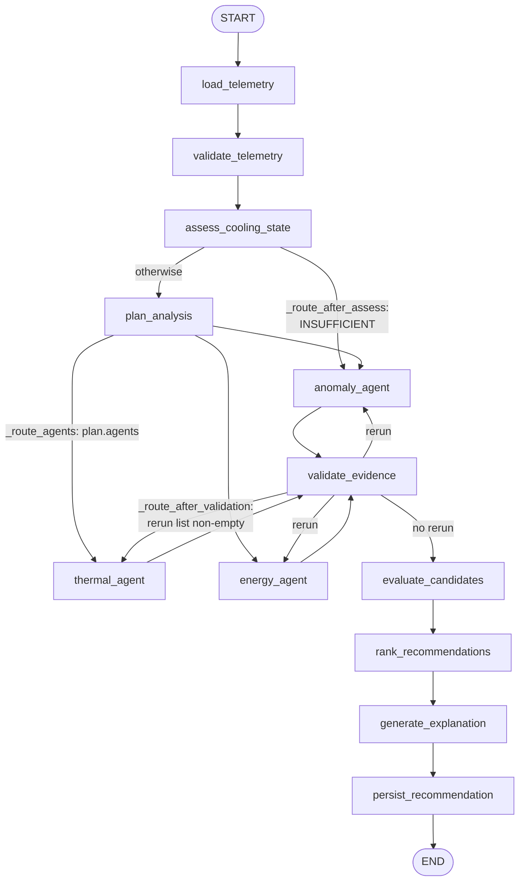
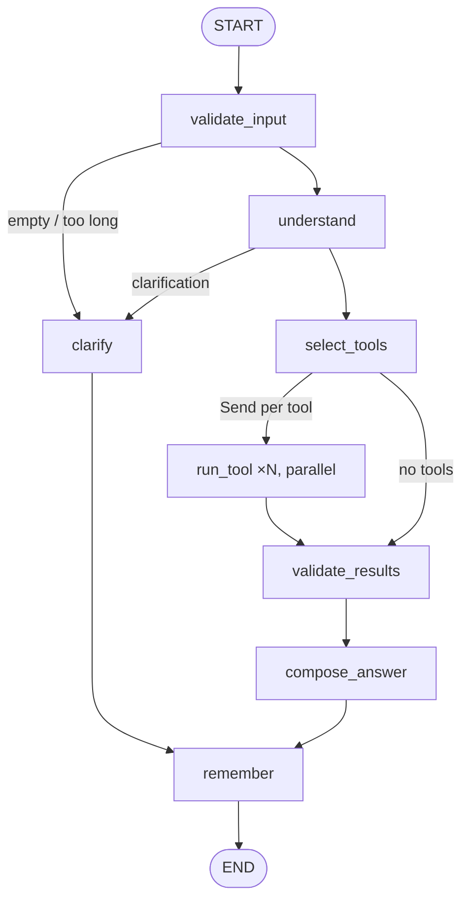

# Agent architecture: LangGraph workflows, specialists and the copilot

Code: `src/data_engineering/recommendations/` (recommendation workflow, shared specialists, LLM adapter)
and `src/data_engineering/copilot/` (copilot). API wrappers: `src/app/recommendations/`,
`src/app/copilot/`. Heuristics: `config/recommendations.yaml`.

## Contents

1. [Design principles](#1-design-principles)
2. [Recommendation workflow](#2-recommendation-workflow)
3. [Operations copilot](#3-operations-copilot)
4. [Fireworks integration, retries and failure behaviour](#4-fireworks-integration-retries-and-failure-behaviour)
5. [Observability, cost and evaluation](#5-observability-cost-and-evaluation)

---

## 1. Design principles

1. **Deterministic code owns facts, numbers and decisions.** `evidence.py` computes every number;
   `rules.py` decides which recommendation types are triggered and what they require; `validator.py`
   decides the final status. An LLM can only select which analyses to run, interpret evidence it is given,
   and phrase explanations.
2. **LLM outputs are schema-bound and number-free.** `AnalysisPlan`, `AgentFinding`, `Explanation`,
   `QueryPlan` and `CopilotAnswer` (`schemas.py`) contain no numeric fields, except the bounds-checked
   copilot window length. They use `extra="forbid"`, enumerated literals (agent names, recommendation types,
   conclusions) and length caps that truncate instead of rejecting.
3. **Free text is checked.** Every number in an LLM explanation or answer must match a value in the
   evidence, configured limits or the given text (tolerance ±0.051 or ±0.5 %; fractions may be quoted as
   percentages; small integers ≤ 10 are allowed as counts). Timestamps and IDs are ignored. Phrases claiming
   an action was carried out are rejected unless negated.
4. **Failure is visible, never silent.** A failed LLM call yields `FAILED`/`FALLBACK` in the trace,
   `INCONCLUSIVE` recommendations and `COMPLETED_WITH_FALLBACK` status, or a deterministic summary with a
   warning in the copilot.
5. **No tools that act.** The recommendation graph's agents have no tools at all. The copilot's tools are
   predefined read-only Python functions. Nothing writes telemetry or commands equipment.
6. **Works without an LLM.** With no `FIREWORKS_API_KEY` or `AGENTS_LLM_ENABLED=false`, both graphs run end
   to end in `mode: deterministic`.

### Why not make everything an LLM call

Telemetry statistics, thresholds, data-quality checks and optimization have exact, testable answers. An
LLM adds latency, cost and a chance of being wrong to each of them. The LLM's value is narrower:
reading a structured evidence list and producing a readable, cited interpretation, and mapping free-form
questions onto tool calls. Even that is backed by deterministic fallbacks, because the safety-relevant
outcome (`REQUIRES_REVIEW` vs `INCONCLUSIVE`) must not depend on a probabilistic component.

### What LangGraph and LangChain each contribute

- **LangGraph** (`StateGraph`, `START`/`END`, `add_conditional_edges`, `Send`) provides typed state with
  reducers for parallel branches, conditional routing, bounded loops (re-analysis), and the node structure
  that the trace follows. No checkpointer is used, so runs cannot be resumed or interrupted for human input
  mid-graph.
- **LangChain** is used only as the model client: `langchain_fireworks.ChatFireworks` with
  `with_structured_output(schema, method="function_calling", include_raw=True)` (structured output plus
  token usage) and `langchain_core.messages`. No LangChain agents, chains, memory or retrievers are used.

---

## 2. Recommendation workflow

`RecommendationEngine` (`recommendations/graph.py`) is built once in the API lifespan
(`src/app/main.py`) and invoked per request by `POST /api/v1/recommendations/generate`, or from the CLI:

```bash
uv run python -m data_engineering.recommendations.cli --asset SIM-NA-013 --run sim-c9944cc35156 \
    --as-of 2026-01-01T13:45:00Z --no-llm
```

### 2.1 Graph



`graph.invoke(..., {"recursion_limit": 40})`. Agents selected by the plan run in the same LangGraph
superstep, that is, in parallel.

### 2.2 State (`WorkflowState`, a `TypedDict`)

| Key | Written by | Notes |
|---|---|---|
| `analysis_id` | `analyze` | `ana-<uuid hex[:20]>` |
| `request` | `analyze` | `{asset_id, run_id, as_of}` |
| `context` | `load_telemetry` | `AnalysisContext`: snapshot, history snapshots, forecast, optimizer result, model summary, configs |
| `telemetry_status` | `validate_telemetry` | `OK` / `DEGRADED` / `INSUFFICIENT` |
| `evidence` | `assess_cooling_state` | `{thermal: [...], energy: [...], anomaly: [...]}` of `Evidence` |
| `rule_candidates`, `not_applicable` | `assess_cooling_state` | From `rules.build_candidates` |
| `required_agents` | `assess_cooling_state` | Agents that must run regardless of the planner |
| `plan` | `plan_analysis` | `{agents, rationale, source: llm|deterministic|fallback, ...}` |
| `agent_results` | agent nodes | Reducer `_merge` (dict union) so parallel branches combine |
| `attempts` | agent nodes | Reducer `_merge`; bounds re-analysis |
| `feedback`, `rerun` | `validate_evidence` | Problems sent back to agents on re-analysis |
| `recommendations` | `evaluate_candidates`, `rank_recommendations` | Validated dicts, then ranked with IDs |
| `explanation` | `generate_explanation` | LLM or template |
| `persisted` | `persist_recommendation` | API response |
| `trace` | every node | Reducer `operator.add`: `{node, status, latency_ms, model?, tokens?, error?}` |

### 2.3 Nodes

| Node | Deterministic / LLM | What it does |
|---|---|---|
| `load_telemetry` | deterministic | Opens one store connection and runs `evidence.gather_context`: the estimator snapshot of the current window, `comparison_windows` (3) previous windows, the XGBoost forecast, and the optimizer result (only if a forecast exists). Closes the connection. **All DB reads happen here** |
| `validate_telemetry` | deterministic | `INSUFFICIENT` if there is no `as_of` or data quality is `INSUFFICIENT`; otherwise the snapshot's data-quality status |
| `assess_cooling_state` | deterministic | Builds evidence (`TH-n`, `EN-n`, `AN-n` IDs) and rule candidates. Required agents: `anomaly` if telemetry is not OK or any `AF_`/`DQ_` finding exists; `thermal` if there are inlet readings; plus the owner of every candidate |
| `plan_analysis` | **main LLM** (`AnalysisPlan`) | Chooses specialists from the snapshot summary. Final set = LLM choice ∪ required. Deterministic mode: all three. LLM error: all three (`source: fallback`) |
| `thermal_agent`, `energy_agent`, `anomaly_agent` | **subagent LLM** (`AgentFinding`) | `specialists.run_specialist` sends the agent's evidence, its eligible types and their requirements, and feedback on re-analysis. The energy agent returns `DETERMINISTIC` without an LLM call when no measured cooling power exists (always, today) |
| `validate_evidence` | deterministic | `validator.check_finding`: unknown evidence IDs cited (in interpretations or the summary text), types the agent may not support (**issues**), and disagreement with the rules in either direction (**conflicts**). Agents with issues/conflicts and attempts ≤ `max_reanalysis_attempts` (1) rerun with feedback |
| `evaluate_candidates` | deterministic | `validator.validate_candidates` (see 2.5) |
| `rank_recommendations` | deterministic | Sort: `REQUIRES_REVIEW` first, then severity, then type priority (PREEMPTIVE_COOLING > AIRFLOW_INVESTIGATION > SENSOR_DATA_QUALITY > MAINTENANCE_INSPECTION > ENERGY_WASTE > COOLING_EFFICIENCY). ID `rec-sha256(run|asset|type|window_end)[:20]` |
| `generate_explanation` | **main LLM** (`Explanation`) | Up to 2 attempts; each is validated by `check_explanation` (one item per recommendation ID, numbers in evidence, no execution claims). Rejection or error → deterministic `template_explanation` |
| `persist_recommendation` | deterministic | `store.save_analysis` (one transaction; dedup on `(run, asset, type, window_end)`), alerts for WARNING/CRITICAL findings, execution summary with tokens and latency |

### 2.4 Recommendation types and their deterministic requirements (`rules.py`)

| Type | Owner | Triggered when | Requirements for `REQUIRES_REVIEW` | Reachable on this data? |
|---|---|---|---|---|
| `PREEMPTIVE_COOLING` | thermal | `TH_APPROACHING_INLET_LIMIT`, `TH_RAPID_INLET_RISE` or `TH_SUSTAINED_INLET_RISE`, **or** a forecast ≥ limit − margin | Configured inlet limit; a forecast exists, is not extrapolated and agrees with the measured trend | Only with stricter limits than the reference 27 °C; forecast skill ≤ 0 adds a warning and makes uncertainty HIGH |
| `AIRFLOW_INVESTIGATION` | anomaly | Any `AF_*` finding | Usable fan, airflow and inlet readings | Only if `AF_*` limits are configured (null by default) |
| `SENSOR_DATA_QUALITY` | anomaly | Serious `DQ_*` findings or physically contradictory evidence | Always `REQUIRES_REVIEW` when triggered | Yes (e.g. a stopped pipeline in a live analysis) |
| `MAINTENANCE_INSPECTION` | anomaly | Same anomaly rule in ≥ `maintenance_min_persistent_windows` (3) consecutive windows | Good data quality in every one of them | Only with configured anomaly rules |
| `ENERGY_WASTE` | energy | Measured cooling power exists | (never `REQUIRES_REVIEW`: no validated comparison method) | **No**: not applicable without cooling power |
| `COOLING_EFFICIENCY` | thermal | Stable workload, inlet not rising, headroom ≥ margin, no thermal/airflow warnings | Optimizer `RECOMMENDATION_AVAILABLE` + measured cooling power | **No**: always `INCONCLUSIVE` with the missing evidence listed |

LLM agents **cannot create** a candidate. They can only support or dispute one, and disputes make it
`INCONCLUSIVE`.

### 2.5 Validator constraints (`validator.validate_candidates`)

For each candidate, in order (any failure → `INCONCLUSIVE` with the reason in `missing_evidence`):

1. Telemetry freshness and completeness. A stale asset, or a stopped pipeline during a **live** analysis,
   blocks everything except `SENSOR_DATA_QUALITY`.
2. A configured inlet limit for thermal types.
3. Model outputs finite, at trained horizons, inputs within the training range.
4. A candidate setting only from a validated, feasible, in-bounds, in-support optimizer result with an
   `intervention_validated` model; otherwise the setting is removed.
5. Evidence units in `ALLOWED_UNITS`, and at least one measured/derived/rule-finding item.
6. The owning agent completed (`OK` or `DETERMINISTIC`), did not fail, and agrees with the rules
   (`FAILED` / `NOT_RUN` / conflicts → `INCONCLUSIVE`). Agent output that failed validation adds a
   warning and is excluded from `agent_assessment`.

**Uncertainty** is a categorical rule (`_uncertainty`), not a probability: `UNKNOWN` if inconclusive;
`HIGH` if data quality is not OK, or the recommendation relies on a forecast that does not beat persistence;
`MEDIUM` for inference- or model-based ones; `LOW` for direct observations with good data quality.

### 2.6 Conflicting conclusions

The rules are the arbiter. If a specialist supports a type whose deterministic requirements are not met, or
fails to support one whose requirements are met, the validator records a conflict. The agent then gets
one re-analysis with the rule results as feedback. A conflict that remains makes that type
`INCONCLUSIVE` with "agreement between the … agent and the deterministic rules" in `missing_evidence`.
Specialists own disjoint types, so two specialists cannot disagree about the same type.

### 2.7 Human-in-the-loop

Every recommendation has `human_approval_required: true` and `automatic_control_executed: false`.
Decisions are recorded with `POST /recommendations/{id}/decisions` and never trigger an action. There is
no in-graph interrupt; review happens after the run.

---

## 3. Operations copilot

`CopilotEngine` (`copilot/graph.py`), built once by `app/copilot/service.py: build_copilot`.

### 3.1 Graph



`recursion_limit` 30. `run_tool` receives one `Send` per selected tool and runs them in parallel; results
merge through the `tool_results` reducer.

### 3.2 Understanding (`understanding.py`), the authority for anything checkable

- **Intents** from keyword lists: `status`, `thermal`, `workload`, `history`, `trend`, `comparison`,
  `forecast`, `energy`, `anomaly`, `maintenance_priority`, `recommendations`, `cooling_setting`,
  `explanation`.
- **Assets** must appear in the operator's scoped list for the run. "all assets", "fleet" or "data center"
  sets `all_assets`. Follow-up words ("it", "this server", "them") reuse the previous turn's assets.
- **Windows:** "last 2 hours", "past 30 min", "previous day", ISO timestamps, or an explicit `time_range`.
  The default is `API_DASHBOARD_TREND_MINUTES` and the maximum `API_MAX_TELEMETRY_RANGE_HOURS`. The basis is
  **simulated event time ending at the newest reading**, stated in `interpretation.time_basis`.
- **Candidate settings** like "3200 rpm" are extracted for the cooling-candidate tool.
- **Clarification** instead of guessing: ambiguous assets; topology words (`zone`, `room`, `aisle`, `rack`,
  `hall`, `row`), since the telemetry has no topology; "the other …" without a second asset; an empty
  window.
- **Optional LLM `QueryPlan`** (main model): it may *add* intents (filtered to the known set), propose
  assets (kept only if they are in the scoped known list and none were parsed), a window (kept only if
  within bounds), or a clarification question. Its output is re-validated; it cannot widen the scope.

### 3.3 Tools (`tools.py`): read-only, scoped, bounded

| Tool | Selected for | Evidence |
|---|---|---|
| `latest` | status, thermal, workload | Latest observed values (measured) |
| `window_summary` | history, trend, thermal, workload, comparison, status | Mean/min/max/trend per asset (calculated) |
| `trend_screen` | trend over all assets | Rising inlet with stable workload, per asset |
| `forecast` | forecast (needs one asset) | XGBoost predictions under observed conditions |
| `energy` | energy | Server IT power; cooling power explicitly `unavailable` |
| `recommendations` | recommendations, maintenance priority | Stored recommendations and alerts |
| `maintenance_priority` | maintenance priority; anomaly over all assets | Triage by severity of findings, alerts, open recommendations |
| `cooling_candidates` | cooling_setting with an asset | Optimizer evaluation (`UNAVAILABLE` reasons today) |
| `specialists` | explanation/anomaly about exactly one asset | Up to 2 specialists (thermal, workload, anomaly, energy) via the shared `run_specialist` |

Each tool opens its own **read-only** connection (SQLite `mode=ro` + `PRAGMA query_only=ON`, PostgreSQL
`default_transaction_read_only=on`) with the `API_QUERY_TIMEOUT_S` statement timeout. It enforces
`AssetScope` and caps assets, range and points (`API_MAX_TELEMETRY_POINTS`). A tool exception becomes
`status: FAILED` with a warning, never a silent omission.

### 3.4 Answer composition

`validate_results` numbers evidence `E1…En` and drops measured values without units. `compose_answer`
sends at most 120 evidence items, the specialist findings and warnings to the main model (`CopilotAnswer`
with sections measured / calculated / predictions / hypotheses / recommendations / limitations). It runs
`check_numbers` and an action-claim check. On failure it re-asks once, then falls back to
`_deterministic_answer`, which is built only from tool outputs. "Why" questions always get the note that
co-occurrence is correlation, not proven causation.

### 3.5 Safety and limits

- **Why the LLM never gets the database or SQL:** unbounded queries could leak out-of-scope assets, exhaust
  resources and break the read-only guarantee. Generated SQL cannot be validated for intent, and numbers
  computed by the model could not be trusted anyway. Predefined tools make scope, bounds and units
  enforceable in code.
- **Prompt injection:** the operator's question reaches the planner and the answer model (and
  specialists as `operator_question`). An injected instruction can at most change wording or tool
  *selection* within the allowed set. The model has no write tools, cannot widen asset scope (re-validated),
  cannot add numbers (checked) and cannot claim actions (checked). Not mitigated: misleading but
  number-free prose that passes the checks.
- **Control requests** ("set the fan to 2000 rpm now") are detected by a regex and answered with a refusal
  note plus the evaluation status.
- **Memory:** `ConversationStore` keeps at most 200 conversations × 10 turns, with a 1 h TTL, in process. It
  stores only the interpretation and a ≤ 300-character answer summary, never raw telemetry. Conversation
  IDs are not bound to a user identity.
- **Citations:** the answer must cite IDs like `[E3]`, but the copilot does not verify each cited ID
  exists (the recommendation validator does verify agent citations). That is a known gap.
- **Unsupported questions** fall back to the `latest` tool; topology questions get a clarification.
- **Known defect:** the topology-word check fires even when asset IDs are present (see
  [API.md, digital twin](API.md#digital-twin)).

---

## 4. Fireworks integration, retries and failure behaviour

`recommendations/llm.py: FireworksStructuredLLM`, built by `build_llms` once at startup.

| Setting | Default | Effect |
|---|---|---|
| Main model | `accounts/fireworks/models/glm-5p3-flash` | Planner, explanation, copilot plan and answer |
| Subagent model | `accounts/fireworks/models/deepseek-v4p1-flash` | Specialists. The originally requested `deepseek-v4-flash-0731` returned 404 for this account on 2026-10-13 |
| `temperature` | 0 | — |
| `reasoning_effort` | `low` | At default effort and 4,096 tokens both models often spent the budget reasoning and never called the tool; GLM rejects `none` |
| `max_tokens` | 8,192 | — |
| `timeout` | 60 s per call | — |
| Transport retries | 1 (`ChatFireworks max_retries`) | Worst case per call ≈ (1 + retries) × timeout |
| Parse retries | 1 | Re-asks with the parsing error when the tool call doesn't match the schema |
| Base URL | `https://api.fireworks.ai/inference/v1` | `/v1` is stripped because ChatFireworks appends it |

Errors become `LLMError(kind)`, with `timeout`, `provider` or `parse`. Prompts, outputs and keys are never
logged; only error types and pydantic error locations are.

| Failure | Recommendation workflow | Copilot |
|---|---|---|
| Provider down / timeout in planner | Plan = all agents (`FALLBACK`) | Deterministic interpretation, warning |
| Specialist fails | Agent `FAILED`; its types `INCONCLUSIVE`; status `COMPLETED_WITH_FALLBACK` | Specialist reported as failed; answer continues |
| Output never matches schema | Same as above (`parse`) | Same |
| Explanation rejected twice | Deterministic template; `rejected_llm_explanation` recorded | Deterministic summary |
| No API key | `mode: deterministic` | `mode: deterministic` |

**Upper bound of LLM calls per recommendation analysis:** planner 1 + thermal 2 + anomaly 2 (each with at
most one re-analysis; energy makes none) + explanation 2 = **7 structured calls**. Each can make up to 2
model round trips (parse retry) and each round trip up to 2 transport attempts. There is no request-level
deadline. **Copilot:** plan 1 + up to 2 specialists + answer up to 2 = 5 structured calls.

Observed in earlier live runs (simulated data; recorded before this documentation pass): planner calls
took about 1–5 s and specialists about 8–18 s each. One re-analysis took 181 s with 2 transport retries,
which is why the default is now 1. Explanations were sometimes rejected by the number check and replaced
by the template, as intended. All recommendations on the real simulated data were `INCONCLUSIVE` or not
applicable, because the injected anomalies stay below the configured limits.

---

## 5. Observability, cost and evaluation

- **Trace:** every node appends `{node, status, latency_ms, model, input/output/total tokens, attempt,
  error}`. The recommendation trace is persisted in `recommendation_analyses.trace_json` and served by
  `GET /recommendations/analyses/{id}`. The copilot trace is returned in
  `agent_execution_summary.nodes` (not persisted).
- **Logs:** one `recommendation analysis finished` line with mode, status, count, ms and tokens; agent
  errors with kind only.
- **Cost control in code:** the energy agent never calls an LLM without cooling power; the planner can
  skip specialists; the copilot runs specialists only for "why"/anomaly questions about one asset (at most
  2); evidence sent to the answer model is capped at 120 items; reasoning effort is `low`.
- **Not implemented:** cost accounting in currency, per-user rate limits, caching of identical analyses
  (the dedup only prevents duplicate *rows*, not duplicate *work*), prompt/version tracking.

### How agent reliability should be evaluated (not done yet)

1. **Golden scenarios** from the simulator's injected anomalies and from synthetic fixtures with known
   physics. Expected recommendation types/statuses per window. Measure precision/recall of
   `REQUIRES_REVIEW`, in deterministic and LLM mode.
2. **Invariant tests at scale:** run N analyses with live LLMs and count number-check rejections,
   citation errors, conflicts, fallbacks and schema failures per 100 calls.
3. **Agreement:** how often the LLM plan adds or omits agents relative to the required set; how often
   specialists conflict with the rules.
4. **Adversarial prompts** for the copilot: injection, scope escalation, control requests, out-of-range
   windows.
5. **Latency and cost:** p50/p95 per node and per analysis, tokens per analysis, from the persisted
   traces.

The existing tests (`tests/test_recommendations.py`, `tests/test_platform_api.py`) use
`tests/recommendation_helpers.ScriptedLLM` for scripted outputs (valid, invalid citations, hallucinated
numbers, execution claims, provider errors). They verify the guards, not model quality.
