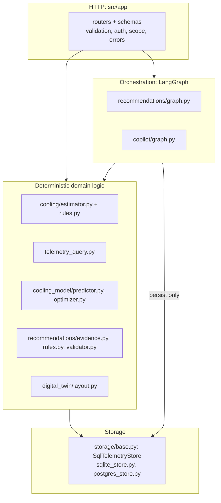
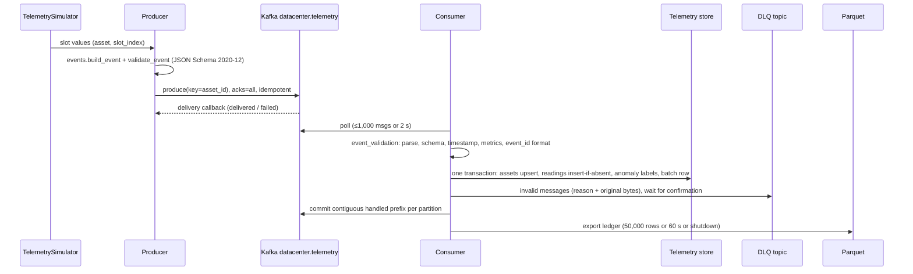
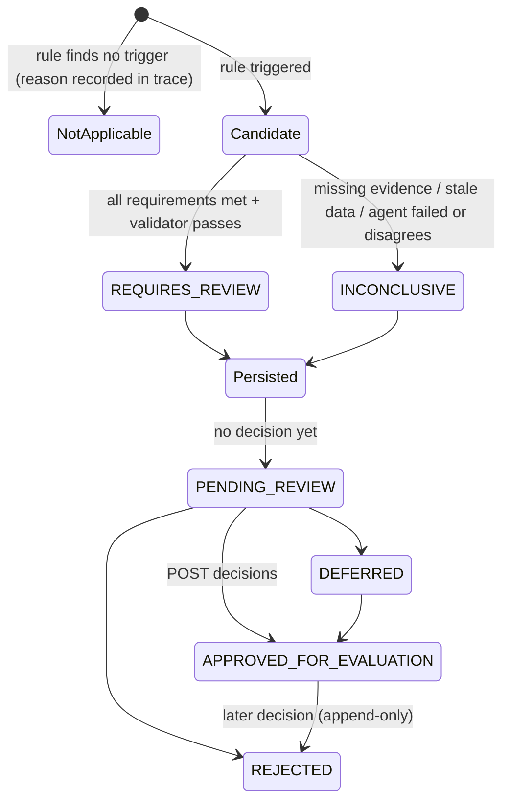
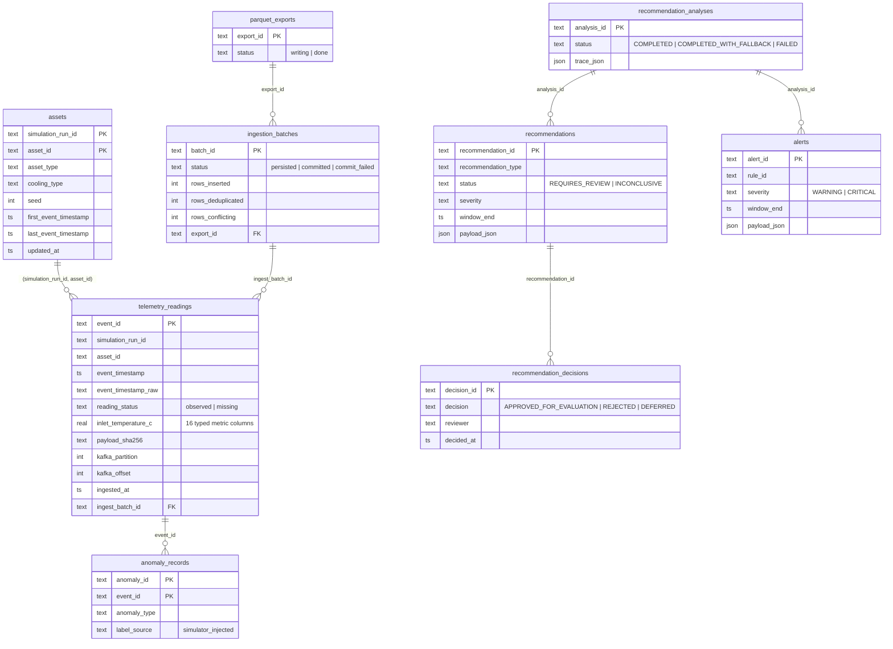

# Architecture

Deep dive behind README §5, §6, §11, §12 and §22. Everything here describes the code as it exists; proposals
are labelled as such. Related: [API.md](API.md), [ML_AND_OPTIMIZATION.md](ML_AND_OPTIMIZATION.md),
[AGENT_ARCHITECTURE.md](AGENT_ARCHITECTURE.md), [DIGITAL_TWIN.md](DIGITAL_TWIN.md),
[PRODUCTION_READINESS.md](PRODUCTION_READINESS.md), [PIPELINE_GUIDE.md](PIPELINE_GUIDE.md).

## Contents

1. [Components and boundaries](#1-components-and-boundaries)
2. [End-to-end data flows](#2-end-to-end-data-flows)
3. [Database and data model](#3-database-and-data-model)
4. [Dataset and data quality](#4-dataset-and-data-quality)
5. [Architecture decision records](#5-architecture-decision-records)

---

## 1. Components and boundaries

The code is split into two Python packages built from `src/` (`[tool.uv.build-backend] module-name =
["data_engineering", "app"]`):

- **`data_engineering`**: everything that is not HTTP. It covers the pipeline, storage, analytics, the
  estimator, the ML model, the agents and the layout. It has no FastAPI imports.
- **`app`**: the FastAPI package. Each domain has `router.py` (HTTP), `schemas.py` (Pydantic contracts),
  `service.py` (calls into `data_engineering`), `dependencies.py` and `exceptions.py`. Domains raise
  `AppError` subclasses; `app/exceptions.py` renders them.

This split means the agents, the model and the estimator can run from a CLI
(`recommendations/cli.py`, `cooling/estimator.py`, `cooling_model/training.py`) with no web server, and
tests can exercise them directly.

### Layering



Rules that hold across the code:

1. **LLMs sit only in L2 and never touch L4.** Agent nodes receive precomputed evidence. Database reads
   happen in `load_telemetry` (recommendations) or in tools (copilot).
2. **Every number comes from L3.** LLM output schemas have no numeric fields, except the copilot plan's
   `window_minutes`, which is bounds-checked and only selects a window.
3. **L4 runs only parameterized SQL.** Table and column names come from constants (`storage/base.py`).
4. **One store, two connection modes.** `StoreFactory.open(read_only=True)` gives SQLite `mode=ro` +
   `PRAGMA query_only` or PostgreSQL `default_transaction_read_only=on`, plus a statement timeout. The
   dashboard, assets, twin and copilot use read-only connections. Recommendations and decisions use
   writable ones.

### Process view

| Process | Started by | Long-lived state | Writes |
|---|---|---|---|
| Producer | `python -m data_engineering.streaming.producer` | librdkafka queue | Kafka |
| Consumer | `python -m data_engineering.streaming.consumer` | offset tracker, DLQ producer | Store, DLQ, Parquet |
| API | `uvicorn app.main:app` | `app.state`: cooling config, StoreFactory, ModelRegistry (boosters in memory), LLM clients, RecommendationEngine (compiled graph), CopilotEngine (compiled graph + ConversationStore), LayoutProvider, TwinBroadcaster | Store (recommendations, decisions, alerts), model artifacts (training only) |
| Training CLI | `python -m data_engineering.cooling_model.training` | — | `models/cooling_response/` |

The API's lifespan (`src/app/main.py`) builds all of this once. An invalid `cooling_state.yaml` fails
startup; a missing model or an unreachable database does not.

---

## 2. End-to-end data flows

### A. Telemetry ingestion



| Step | Code | Behaviour |
|---|---|---|
| Event time | `simulation/generate_telemetry.py`, `streaming/sources.py` | `event_timestamp = start + slot_index × interval` (UTC, simulated). `timestamp_source: "simulated"`. Never `now()` |
| Contract | `streaming/telemetry_event.v1.schema.json` | 16 metrics, all numbers when `observed`, all `null` when `missing`; `field_sources` provenance; no unknown fields |
| Key/partition | `producer.py` | Key `asset_id`, so one asset is always in one partition, in order |
| Validation (consumer) | `event_validation.py` | Reason codes `malformed_json`, `schema_violation`, `invalid_timestamp`, `invalid_metric_value`, `invalid_identifier`, `unsupported_schema_version` |
| Transformation | `storage/base.py: prepare_event` | Event → `assets` row, `telemetry_readings` row (typed metric columns), `anomaly_records` rows |
| Duplicates | `persist_batch` | Insert if `event_id` absent. Same ID + same `payload_sha256` → `rows_deduplicated`; different content → `rows_conflicting`, warning log, first version kept |
| Missing data | schema + `CHECK` constraint | `reading_status='missing'` with all metrics NULL; never 0 |
| Units | schema descriptions | Inferred from column names; returned per metric by the API (`telemetry_query.UNITS`) |
| Failure recovery | `consumer.py` | Bounded exponential backoff with jitter; nothing committed past a failure; DLQ outage blocks only the affected partition prefix |
| Availability | — | A reading is visible to the API as soon as its batch transaction commits (typically ≤ 2 s after arrival) |

The full operating detail (offsets, rebalances, retries, measured crash tests) is in
[PIPELINE_GUIDE Part II](PIPELINE_GUIDE.md#part-ii-consumer-storage-and-analytics).

**Update frequency.** The producer controls it: `--speedup 1` sends one reading per asset per real
minute, `--speedup 60` one simulated minute per second, and no pacing sends as fast as possible. The API
does not poll Kafka. It reads the store, and the twin's SSE poller rereads the store every
`API_TWIN_POLL_INTERVAL_S` (10 s).

### B. Dashboard query

`GET /api/v1/dashboard/overview` → `app/dashboard/router.py: overview` → `DashboardService.overview`:

1. `app/assets/scope.py: run_assets` checks the asset scope, resolves the run (`store.latest_run_id()`,
   the run whose `assets.updated_at` is newest), loads `assets` rows and filters them by scope.
2. `telemetry_query.window_bounds` resolves `(start, end]`. The default end is the newest
   `last_event_timestamp` in the run, the default length is `API_DASHBOARD_TREND_MINUTES`, and ranges
   over `API_MAX_TELEMETRY_RANGE_HOURS` are rejected (422).
3. `tq.latest_per_asset` → `store.latest_observed`: one aggregate query with a self-join. Duplicates
   collapse to the latest ingested row.
4. Freshness: an asset is fresh if `end − latest ≤ stale_after_seconds` (event time). The pipeline is stale
   if wall-clock `now − max(assets.updated_at) > max_ingest_age_seconds`. Both produce `warnings`, not
   errors.
5. Thermal risk: `CoolingStateEstimator.evaluate(asset_id, run_id, None, end)`, the same rules as
   `/telemetry/cooling-state`.
6. Trends: `store.run_readings_window` (capped at `API_MAX_TELEMETRY_POINTS + 1` to detect truncation),
   bucketed **per asset** by `tq.series`, then averaged across assets with equal weight per asset, plus
   a least-squares slope per minute.
7. Anomaly labels (`anomaly_labels_between`, labelled as simulator ground truth, not detections) and
   alert counts (`list_alerts`).

Empty data: no runs → `404 unknown_run`; no in-scope assets → `422`; an asset with no observed reading
is listed under `assets.without_reading`; KPIs with no reporting assets are `null`, never 0.

### C. Thermal prediction

`POST /api/v1/cooling/predict` → `CoolingModelService.predict_v2`:

1. Resolve the run; check that the asset exists in it (404 otherwise).
2. `availability()`: no model (`MODEL_NOT_TRAINED` / `MODEL_ARTIFACT_INVALID`), feature config changed
   since training (`FEATURE_SCHEMA_MISMATCH`), artifact older than `API_MODEL_MAX_AGE_DAYS`
   (`MODEL_STALE`). Any reason → `status: UNAVAILABLE`, HTTP 200.
3. Requested horizons are intersected with the trained ones (`unsupported_horizons`,
   `HORIZON_NOT_SUPPORTED`).
4. `CoolingResponseModel.predict_for_asset` reads `(as_of − 16 min, as_of]` (`readings_window`). It builds
   the `Series` (dedupe, missing → NaN, non-GPU GPU → NaN), then features with `features.build_features`,
   the same function training uses. It takes the last row.
5. Quality flags: the latest inlet is missing → `INSUFFICIENT_TELEMETRY`; fewer than 16 readings or
   missing lag features → `DEGRADED`; latest reading more than 120 s before `as_of` → `DEGRADED`; nothing
   ingested for 300 s (wall clock) → `DEGRADED`; features outside the training [min, max] → warnings.
6. Each booster predicts Δ, and the response returns `inlet(t) + Δ`, persistence `inlet(t)`, and the
   offline test RMSE/MAE and skill per horizon as `evaluation`.

The legacy `GET /cooling-model/predict` runs the same steps 4–6 but returns `503` instead of
`UNAVAILABLE`.

### D. Cooling optimization

`POST /api/v1/cooling-optimizer/recommend` (configured grid) and `POST /api/v1/cooling/optimize`
(operator candidates) → `cooling_model/optimizer.py: recommend`. It forecasts under current conditions,
then accumulates reasons. With a blocking reason it returns `UNAVAILABLE`, and operator candidates are
echoed as `evaluated: false` with bound/support checks where computable. Only with an
`intervention_validated` model, T_safe and bounds does it evaluate candidates
(`counterfactual_features` → `predict_delta`) and return `CONSTRAINTS_ONLY` or `NO_FEASIBLE_SETTING`.
`RECOMMENDATION_AVAILABLE` needs an energy function, which is `None` everywhere in the code today. See
[ML_AND_OPTIMIZATION §2](ML_AND_OPTIMIZATION.md#2-cooling-optimization-and-safety).

### E. Multi-agent investigation

`POST /api/v1/recommendations/generate` → `get_analysis_service` (opens and closes one connection first, so
an unavailable store fails fast with 503) → `RecommendationService.analyze` (scope check) →
`RecommendationEngine.analyze` → `graph.invoke(..., {"recursion_limit": 40})`. Node by node, with the
deterministic/LLM boundary, in [AGENT_ARCHITECTURE §2](AGENT_ARCHITECTURE.md#2-recommendation-workflow).

### F. Digital twin interaction

`GET /digital-twin/layout` → `GET /digital-twin/state` → `GET /digital-twin/overlays?type=…` →
`GET /digital-twin/stream` → click → `GET /digital-twin/assets/{object_id}` → `POST /digital-twin/analyze`.
Identity: layout `id` ↔ `asset_id` from the YAML, validated unique on load. See
[DIGITAL_TWIN.md](DIGITAL_TWIN.md).

### G. Recommendation lifecycle



- **Persistence.** `store.save_analysis` writes the analysis, recommendations and alerts in one transaction.
  `INSERT … ON CONFLICT (simulation_run_id, asset_id, recommendation_type, window_end) DO NOTHING`, so
  re-running an analysis for the same window does not duplicate rows. The response lists the existing IDs in
  `duplicates_of_existing`.
- **Review status** is the latest decision (`RecommendationService._review_status`). Decisions are
  append-only. `reviewer` is free text from the request body, **not** bound to an authenticated identity.
- **What does not exist:** acknowledgement or resolution states, expiry, linking a decision to an executed
  change, notifications.

---

## 3. Database and data model

### Telemetry store (schema version 2)



The SQLite schema declares these foreign keys. Uniqueness that matters for idempotency:
`telemetry_readings.event_id` (PK), `recommendations (run, asset, type, window_end)`, and
`alerts (run, asset, rule_id, window_end)`.

### Indexes and the queries they serve

| Index | Serves | Note |
|---|---|---|
| `telemetry_readings (asset_id, event_timestamp)` | `readings_window` (estimator, forecast, history), `latest_observed` | Leads with `asset_id`, not `simulation_run_id`: as runs accumulate, each asset's index range spans all runs and the run filter is applied afterwards |
| `telemetry_readings (event_timestamp)` | Time-range scans | — |
| `telemetry_readings (ingest_batch_id)` | Parquet export reads | — |
| `assets (asset_id)` | Lookups across runs | — |
| `anomaly_records (asset_id, event_timestamp)` | Anomaly labels in a window | — |
| `ingestion_batches (export_id, persisted_at)` | Finding unexported batches | — |
| `recommendation_analyses (simulation_run_id, asset_id, created_at)` | Per-asset analysis history | — |
| `recommendations (created_at)`, `alerts (created_at)` | Keyset pagination `ORDER BY created_at DESC, id` | Filters on asset/status are applied without a composite index |
| `recommendation_decisions (recommendation_id, decided_at)` | Review status | Queried once per listed recommendation (N+1) |

### Timestamps and time zones

- All instants are UTC. SQLite stores fixed-width text `YYYY-MM-DDTHH:MM:SS.ffffffZ`, so lexical order
  equals chronological order (mixed precision would sort wrongly). PostgreSQL uses `TIMESTAMPTZ`.
- `event_timestamp` is simulated measurement time (2026-01-01 in the default run); `ingested_at` and
  `updated_at` are wall clock. Freshness rules use both, deliberately: event-time staleness means a sensor
  stopped reporting; wall-clock staleness means the pipeline stopped.
- `event_timestamp_raw` keeps the exact received string for traceability.
- API inputs must include a timezone (`UtcDatetime` rejects naive datetimes) and are normalized to UTC.

### Events, current state, aggregates, caches

| Concept | Exists? | Where |
|---|---|---|
| Telemetry events | Yes | `telemetry_readings` (append-only, deduplicated) |
| Current state | **Computed per request** | `latest_observed` + estimator; no state table |
| Historical aggregates | Computed per request | `telemetry_query.series` (epoch-aligned buckets); DuckDB over Parquet (CLI) |
| Cache / materialized view | **No** | The only cache is the layout (reloaded on mtime change) and the loaded model |
| Retention / cleanup | **No** | Rows grow without bound; Parquet export makes deletion of exported rows possible later |

### Phase 1 database (`data/datacenter_ops.db`, `db/schema.sql`)

`source_records` (all 100,000 source rows, `provenance='dataset'`), the NA subset
(`region_filtered_records` / view `filtered_source_records`), `simulation_runs`, `asset_metadata`
(`identifier_origin='synthetic'`), the stored run's `telemetry_readings` (`is_missing=1` rows for missing
slots), and `anomaly_events` + `anomaly_labels` (clean and injected values). It is separate on purpose:
it has a different `telemetry_readings` table, and `db/init_telemetry_store.py` refuses to initialize the
store inside it.

---

## 4. Dataset and data quality

### Source

Kaggle `deeplumiere/hyperscale-data-center-dataset` (MIT license as reported by the Kaggle CLI). One CSV,
`green_ai_datacenter.csv`, 100,000 rows × 35 columns, 0 empty cells. Its metadata calls it an *"Engineered
synthetic dataset optimized for KNIME/Tableau ML experiments"*. Column-by-column inspection:
[dataset/README.md](dataset/README.md); machine profile: [dataset/profile.json](dataset/profile.json).

### What is used and how it is turned into telemetry

| Dataset content | Use |
|---|---|
| 16 numeric columns (workload, CPU/GPU/memory/storage utilization, IOPS, network, ambient, humidity, inlet, exhaust, fan, airflow, power, PUE) | Simulated per minute as the event `metrics` |
| `server_type`, `cooling_type`, `server_age_years`, `rack_u_position`, `energy_source_primary` | Static `asset_attributes` |
| `failure_risk_level`, `energy_efficiency_class`, `maintenance_status` | Static `labels.source_*` per asset (not time-varying risk) |
| `cooling_efficiency`, `power_supply_efficiency`, `wue`, carbon and cost columns | **Not simulated**: reported as unavailable |

Simulation model (`config/simulation.yaml`, `generate_telemetry.py`), per asset:

```
x_m(t) = baseline_m + slope_m · (driver(t) − driver_baseline) + ε_m(t)
ε_m(t) = φ · ε_m(t−1) + η,   φ = 0.97,   stationary std = 0.10 × residual std of m (NA rows, same server_type)
driver = workload_intensity for every metric, except airflow_cfm (driver fan_speed_rpm)
         and disk_io_iops (driver storage_utilization)
workload(t) = baseline + diurnal term (±0.10, peak 14:00 UTC) + smoothed regime changes
```

Slopes are fitted by least squares on NA rows of the asset's server type, and clean values are clipped to
the observed source range.

### Consequences that matter downstream

- **Inlet temperature never depends on fan speed.** Any learned fan→inlet association is a coincidence of
  shared drivers. That is why the validity check finds no response
  ([ML_AND_OPTIMIZATION §1.6](ML_AND_OPTIMIZATION.md#16-validity-forecasting-is-not-intervention)).
- **Correlations are engineered.** Fan ↔ airflow is r = +0.995 by construction, workload ↔ CPU +0.97, and
  server age ↔ power-supply efficiency −1.00 in the source.
- **Minute-to-minute inlet noise is AR(1) around a workload-driven level.** It is unpredictable by
  construction, which explains why the forecaster cannot beat persistence.
- **Anomalies:** `thermal_rise` (ramp, 3 per run, +3 σ), `power_spike` (step, +4 σ),
  `network_latency_spike` (step, +4 σ). There are no airflow or fan anomalies, so the `AF_*` rules have no
  ground truth. The default run's injected thermal rises stay below the 27 °C reference limit (the hottest
  inlet in the default run is 24.83 °C), so thermal-limit rules fire only with stricter trial limits.
- **Missing values:** 1 % of slots (`missing_rate: 0.01`), whole slots only. No partial-field gaps, no
  sensor drift, no clock skew, no out-of-order arrival within an asset.
- **Outliers:** injected anomaly values are not clipped. There is no outlier filter in the pipeline:
  the estimator reports what it sees, and data-quality rules detect gaps, duplicates and irregular
  intervals, not implausible values (except physically contradictory evidence in
  `recommendations/evidence.py`, such as zero airflow while the fan rotates).

### Leakage risks and how they are handled

| Risk | Handling |
|---|---|
| Same-seed runs replay identical series | `cooling_model/dataset.py: select_training_runs` keeps one run per seed (longest, then most assets) |
| Temporal leakage through random splits | Chronological split on event time with purging ([ML §1.3](ML_AND_OPTIMIZATION.md#13-chronological-split-and-purging)) |
| Future values in features | Lags looked up by exact timestamp ≤ t; rolling windows `(t−w, t]` |
| Categories from test data | One-hot categories learned on the training split only |
| Asset IDs repeat across runs | Every query is scoped to one `simulation_run_id`. Note: the per-asset *evaluation summary* groups by `asset_id` only, so same-named assets of different runs are merged there (20 groups for 30 test series) |

### Why good metrics here do not establish physical validity

Real telemetry has control loops (fans react to temperature), thermal inertia and coupling between
neighbouring servers, recirculation, sensor drift and calibration error, non-stationary workloads,
maintenance events and clock problems. None of that is in this data. A model that does well here has
learned the simulator's equations, not a data center. Every API response that carries model output
includes the limitation text `Trained and evaluated on SIMULATED telemetry only`.

---

## 5. Architecture decision records

Format: Context → Decision → Alternatives → Advantages → Disadvantages → Failure modes → Revisit when.
"Evidence" says whether anything was measured. Most alternatives were **not** evaluated experimentally.

### ADR-1: FastAPI for the HTTP layer
- **Context:** typed contracts for many JSON endpoints, OpenAPI for a future frontend, SSE, sync DB code.
- **Decision:** FastAPI with sync `def` handlers on a bounded threadpool (`API_THREADPOOL_TOKENS=40`); one
  store connection per request.
- **Alternatives:** Flask (no native typed validation), Django REST (ORM-centric), Litestar.
- **Advantages:** Pydantic validation with `extra="forbid"`, generated `/docs`, dependency injection for
  scope/auth/session.
- **Disadvantages:** sync handlers tie up a thread for the whole request, including LLM calls of tens of
  seconds.
- **Failure modes:** threadpool exhaustion under concurrent `/recommendations/generate` calls; SQLite
  connections crossing threads (handled with `check_same_thread=False`, one thread at a time).
- **Evidence:** a concurrency test caught the cross-thread SQLite bug; no load test exists.
- **Revisit when:** agent runs move to a job queue, or SSE fan-out needs thousands of clients per process.

### ADR-2: SQL (SQLite/PostgreSQL) rather than NoSQL or a time-series database
- **Context:** fixed, versioned telemetry schema (16 metrics); idempotency needs unique keys and
  transactions; local development without services.
- **Decision:** hand-written SQL shared by SQLite and PostgreSQL; typed metric columns; Parquet + DuckDB
  for history.
- **Alternatives:** MongoDB/document store (schemaless, weaker constraints), InfluxDB, TimescaleDB,
  ClickHouse.
- **Advantages:** `CHECK` constraints (missing readings must have NULL metrics), `ON CONFLICT` idempotency,
  one transaction per batch, zero-setup default.
- **Disadvantages:** no partitioning or retention; per-request aggregation; SQLite allows one writer.
- **Failure modes:** `database is locked` when the consumer and the recommendation writer contend (5 s
  busy timeout); unbounded table growth.
- **Revisit when:** more than one facility, retention needs, or rollups — then TimescaleDB hypertables
  with continuous aggregates.

### ADR-3: XGBoost instead of a deep time-series model
- **Context:** tabular, per-minute features; small data (46,320 asset-minutes in training); CPU only;
  explainability needed.
- **Decision:** one XGBoost regressor per horizon on the inlet *change*, with explicit lag/rate/rolling
  features.
- **Alternatives:** linear AR(p), LightGBM, LSTM, Temporal Fusion Transformer, N-BEATS.
- **Advantages:** handles NaN natively, trains in seconds, deterministic with a seed, portable `.ubj`
  artifacts, gain-based feature reports.
- **Disadvantages:** no native uncertainty; extrapolates poorly; features must be engineered.
- **Evidence:** measured. It does not beat persistence pooled (−4.0 % / −1.4 % RMSE skill). The simulator's
  noise makes the target near-unpredictable, so a deep model is unlikely to help *on this data*. That was
  not tested.
- **Revisit when:** real telemetry with longer dependencies, many correlated sensors, or a need for
  probabilistic forecasts.

### ADR-4: LangGraph instead of a plain function pipeline
- **Context:** conditional routing (insufficient telemetry → anomaly agent only), parallel specialists,
  a bounded retry loop driven by validation, per-node tracing.
- **Decision:** two compiled `StateGraph`s with typed state, reducers for parallel merges
  (`Annotated[dict, _merge]`, `operator.add` for the trace) and `Send` fan-out in the copilot.
- **Alternatives:** plain Python functions with `concurrent.futures`; LangChain agents (tool-calling
  loops); CrewAI/AutoGen.
- **Advantages:** the control flow is explicit and inspectable; loops are bounded by state and
  `recursion_limit`; the trace falls out of the node structure.
- **Disadvantages:** a dependency and a learning curve for what is ~10 nodes; no checkpointer is used, so
  the persistence/resume features are unused.
- **Evidence:** none comparative. A plain pipeline would be functionally equivalent today.
- **Revisit when:** if human-in-the-loop interrupts or resumable runs are needed, LangGraph's checkpointing
  becomes the main reason to keep it. If not, a plain pipeline is simpler.

### ADR-5: Multiple specialist agents instead of one LLM with tools
- **Context:** the evidence naturally splits by domain (thermal, energy, anomaly/data quality).
- **Decision:** specialists receive only their evidence slice and may only support their own
  recommendation types (`TYPE_OWNER`). A planner chooses which to run. The validator compares each
  agent's view with the deterministic rule result.
- **Alternatives:** one LLM call with all evidence; one tool-calling agent.
- **Advantages:** smaller prompts per call; ownership makes disagreements attributable; parallel
  execution; a failed agent affects only its types.
- **Disadvantages:** more calls (latency and cost); the planner adds a round trip whose decision the
  rules can override anyway.
- **Evidence:** none comparative.
- **Revisit when:** measurements show a single call is as accurate, then collapse to one call for cost.

### ADR-6: SSE instead of WebSockets for live twin updates
- **Context:** one-directional server → client updates; 1-minute telemetry.
- **Decision:** `GET /digital-twin/stream` with event IDs, `Last-Event-ID` replay, heartbeats, and
  `resync_required`.
- **Alternatives:** WebSockets, long polling, plain polling of `/state?since=`.
- **Advantages:** plain HTTP, automatic reconnect in browsers, replay semantics fit naturally, works
  through most proxies.
- **Disadvantages:** native `EventSource` cannot send an `Authorization` header; one long-lived
  connection per client.
- **Failure modes:** event IDs are per process and reset on restart; multi-replica deployments break
  replay.
- **Revisit when:** the client needs to send commands (it must not, for control) or connection counts
  exceed a process.

### ADR-7: REST APIs plus an internal event log, not event-driven integration end to end
- **Decision:** Kafka between ingestion stages; REST for every consumer of results.
- **Why:** the consumers of results are humans and a UI asking questions; request/response fits.
  Recommendations are generated on request, not from a stream.
- **Trade-off:** there is no continuous detection; alerts exist only when someone runs an analysis.
- **Revisit when:** continuous alerting is needed. Then add a detector consumer group that writes
  alerts, and publish alert events to a topic.

### ADR-8: Polling the store for twin updates instead of streaming from Kafka to the browser
- **Decision:** one shared poller per API process reads a compact snapshot every 10 s and diffs it.
- **Why:** the store is already the deduplicated source of truth; reading Kafka in the API would need a
  second consumer group and its own dedup.
- **Trade-off:** up to 10 s extra latency (fine for 1-minute data); the cost is O(assets) per poll, not
  per client.
- **Revisit when:** sub-second telemetry or thousands of assets. Then maintain current state in a stream
  processor and push deltas.

### ADR-9: A 3D digital twin instead of (or in addition to) a 2D dashboard
- **Decision:** backend support for a spatial view (layout, overlays, inspection), with the dashboard
  API in parallel.
- **Why:** spatial context (rack, aisle, adjacent hot spots) is how operators reason about cooling.
- **Trade-off:** the telemetry has no topology, so the layout is invented, and a 3D view risks implying
  physical fidelity that doesn't exist. Mitigations: `demonstration: true` and a notice in every response.
- **Revisit when:** a verified facility layout and sensor mapping exist.

### ADR-10: Recommendation-only instead of automatic control
- **Decision:** no actuation path; `recommendation_only` cannot be disabled; decisions only record a
  human review.
- **Why:** no validated causal response, no cooling power, no verified limits. Automatic control on an
  observational forecaster could overheat equipment.
- **Trade-off:** no realized savings without humans in the loop.
- **Revisit when:** the prerequisites in [ML_AND_OPTIMIZATION §2.6](ML_AND_OPTIMIZATION.md#26-prerequisites-for-closed-loop-control) are met, after a safety review.

### ADR-11: Synthetic data instead of real telemetry
- **Decision:** simulate time series from an engineered dataset, label everything `simulated`, and record
  provenance per field (`field_sources`).
- **Why:** no real telemetry was available; the dataset has no time axis.
- **Trade-off:** all quantitative results are about the simulator.
- **Revisit when:** any real data source is available. The event contract and pipeline are
  source-agnostic; a new `source_type` value and schema version would be needed.

### ADR-12: Synchronous request processing for agent workflows
- **Decision:** `POST /recommendations/generate` runs the whole graph inside the request.
- **Why:** simplest correct behaviour for a demo; the result is persisted and returned at once.
- **Trade-off:** latency of tens of seconds with LLMs; client timeouts; a thread held per analysis; no
  cancellation.
- **Revisit when:** more than a handful of concurrent users. Then return `202` with a job ID, run the
  analysis in workers, and expose status via the existing `GET /recommendations/analyses/{id}`.
