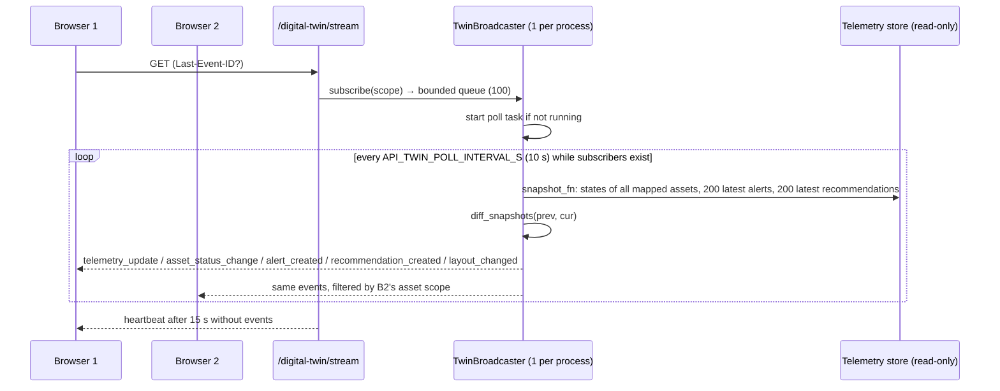

# Digital twin

**What exists:** a backend in `src/app/digital_twin/` (router, `TwinService`, SSE broadcaster) and
`src/data_engineering/digital_twin/layout.py` (layout model, validation, versioning, reload), plus the
layout file `config/digital_twin_layout.yaml`.

**What does not exist:** any frontend. The repository contains no Three.js, React or other browser code.
The client contract is [frontend_integration.md](frontend_integration.md). The Three.js sections below are
the intended client design, labelled as such.

**The layout is a DEMONSTRATION.** The telemetry has no room, aisle, rack or position data. Rack
membership, coordinates and dimensions are illustrative, and every layout response carries
`demonstration: true` and a `notice`.

## Contents

1. [Backend model](#1-backend-model)
2. [State, overlays and inspection](#2-state-overlays-and-inspection)
3. [Live updates (SSE)](#3-live-updates-sse)
4. [Three.js client design (not built)](#4-threejs-client-design-not-built)
5. [What this twin is and is not](#5-what-this-twin-is-and-is-not)
6. [Scaling to large facilities](#6-scaling-to-large-facilities)

---

## 1. Backend model

### Hierarchy and coordinates

```
dc-na-1 (facility)
└── room-1 (room, "Data hall 1")
    ├── aisle-1 ── rack-11 (srv-001 … srv-005)   rack-12 (srv-006 … srv-010)
    ├── aisle-2 ── rack-21 (srv-011 … srv-015)   rack-22 (srv-016 … srv-020)
    ├── crah-1 (cooling_unit, no telemetry)
    └── crah-2 (cooling_unit, no telemetry)
```

- **Types and allowed parents** (`ALLOWED_PARENT`): facility → none; room → facility; aisle → room;
  rack → aisle or room; server → rack; cooling_unit → room or aisle.
- **Coordinates:** metres, `position` = object centre in room coordinates, x east, y up, z north.
  `rotation` in the same frame; `dimensions` = width/height/depth.
- **Validation on load** (`parse_layout`): unique non-empty IDs, valid types, parents exist and are of an
  allowed type, no cycles, finite coordinates, positive dimensions, each `asset_id` mapped at most once,
  well-formed overlay bands. All problems are reported together. An invalid file gives `503 layout_invalid`;
  a missing one `503 layout_not_configured`.
- **Version:** `<revision>-<content hash>` (e.g. `demo-1-7a5a2f8c47`), so any edit changes it.
  `LayoutProvider` reloads when the file's modification time changes (`DIGITAL_TWIN_LAYOUT` overrides the
  path).

### Identity: layout objects vs telemetry assets

| Identity | Example | Owned by | Stability |
|---|---|---|---|
| Layout object `id` | `srv-013`, `rack-21` | Layout file | Stable across layout versions (contract) |
| Telemetry `asset_id` | `SIM-NA-013` | Simulator/telemetry | Unique only **within a simulation run** |
| `simulation_run_id` | `sim-c9944cc35156` | Simulator | Deterministic from config + source checksum |

Only `server` objects carry `asset_id`. The twin resolves asset IDs against one run (the request's
`run_id`, or the most recently updated run). An object whose asset is not in that run gets
`status: NO_TELEMETRY` / `telemetry_available: false`. A client must identify meshes by `id` and never by
position. Every state, overlay and stream payload carries both `object_id` and `asset_id`.

Consistency risk: the mapping is maintained by hand in YAML. If a run has a different number of assets
(e.g. a 5-asset run), the remaining servers show `NO_TELEMETRY`. Nothing verifies that a mapped server is
physically where the layout says it is; there is no physical ground truth here.

---

## 2. State, overlays and inspection

### `GET /digital-twin/state`: `TwinService._states`

1. Resolve the run; load its assets; keep mapped assets that are in the operator's scope.
2. **One** query for the latest observed readings of all visible assets (`tq.latest_per_asset`). One alert
   query and one recommendation query (each capped at 2,000 rows) are counted per asset.
3. Per server: `values.<metric> = {value, unit, kind}` with kind `measured` or `calculated`
   (`temperature_delta_c`); `cooling_efficiency` is always `{value: null, kind: "unavailable"}`.
4. **Freshness** (event time): `FRESH` if the latest observed reading is within `stale_after_seconds`
   (300 s) of the run's newest reading, otherwise `STALE`; `NO_DATA` if none.
5. **Thermal status** (only when fresh): `ABOVE_LIMIT` (inlet ≥ `inlet_temperature_high_c`),
   `APPROACHING_LIMIT` (within `inlet_approach_margin_c`), `WITHIN_LIMIT`, or `UNKNOWN` when the limit is
   unset or the data is not fresh.
6. **Aggregates** for racks, aisles, rooms and the facility, over child servers with fresh data:
   `max_inlet_temperature_c`, `mean_workload_intensity`, `sum_server_power_kw`, `worst_thermal_status`,
   `servers_reporting`, `kind: aggregated`, and a `method` string.

`since=<state_cursor>` returns only assets with newer readings, which supports polling clients.

### `GET /digital-twin/overlays?type=…`

| Type | Value | Source | Status |
|---|---|---|---|
| `temperature` | latest inlet °C | telemetry | band from `overlay_bands.temperature` (cool ≤ 21, normal ≤ 24, warm ≤ 26, hot) |
| `predicted_temperature` | XGBoost inlet at the longest trained horizon | xgboost | same bands; `is_predicted: true`; warning with label and offline RMSE; `UNAVAILABLE` without a usable model |
| `workload` | `workload_intensity` | telemetry | low ≤ 0.3, medium ≤ 0.7, high |
| `thermal_risk` | estimator state | cooling_state_estimator | estimator severity |
| `energy` | server IT power kW | telemetry | low ≤ 100, medium ≤ 200, high; warning: not cooling power |
| `airflow` | airflow cfm (magnitude) | telemetry | low ≤ 150, medium ≤ 220, high; warning: no direction or paths |
| `cooling_efficiency` | — | none | always `UNAVAILABLE` |
| `data_quality` | reading age s | telemetry | `FRESH` / `STALE` / `NO_DATA` |

Bands are **visual** thresholds from the layout file, not equipment limits (`bands_note` says so). With
`timestamp=…`, the overlay is evaluated as of that historical time.

### Measured, calculated, predicted, illustrative

| Kind | Examples | Where it comes from |
|---|---|---|
| Measured (simulated) | inlet, exhaust, fan, airflow, CPU, IT power | stored telemetry |
| Calculated | delta-T, freshness, thermal status, overlay band | computed per request |
| Aggregated | rack max inlet, mean workload, summed IT power | child servers with fresh data |
| Predicted | `predicted_temperature`, inspection forecast | XGBoost under observed conditions |
| Illustrative | coordinates, rack membership, CRAH units | layout file only |

### Inspection and analysis

- `GET /digital-twin/assets/{object_id}` (an `asset_id` also works): for a server, the object, its
  parents, `AssetService.detail` (latest reading and cooling state), a 5-minute bucketed history, the
  `/cooling/predict` forecast and the latest 10 alerts and recommendations. For racks/rooms:
  `kind: aggregated` with child summaries.
- `POST /digital-twin/analyze`: resolves the object to its in-scope assets, appends an analysis-type hint
  ("temperature trend", "investigate first", …) and, for several assets, their IDs to the question, and
  calls the **same** copilot engine (no second agent implementation). Defect: questions containing
  topology words return a clarification ([API.md](API.md#digital-twin)).

---

## 3. Live updates (SSE)

`src/app/digital_twin/stream.py: TwinBroadcaster`, created by the lifespan.



- **Cost is per poll, not per client:** one snapshot per process for all subscribers.
- **Event IDs** increase monotonically per process. A reconnect with `Last-Event-ID` replays missed events
  from a 500-event ring buffer. If the gap is no longer buffered (or exceeds the queue), the client gets
  `resync_required` and must re-fetch `/state`.
- **Backpressure:** each subscriber's queue holds 100 events. When it is full, the oldest is dropped and
  `resync_required` is sent.
- **Store outage:** the poll publishes `resync_required` ("telemetry store temporarily unavailable") and
  the stream stays open.
- **Limits:** `API_TWIN_MAX_SUBSCRIBERS` (50) → `503 stream_capacity_reached`; `max_events` closes a stream
  after N events (useful for tests and polling clients).
- **Auth:** the stream sits behind `require_operator`, but browsers' native `EventSource` cannot send an
  `Authorization` header. With `API_AUTH_TOKEN` set, use a fetch-based SSE client.
- **Single-process design:** IDs reset on restart; several workers or replicas each have their own
  broadcaster and IDs, so replay across them is wrong. The first poll after the poller restarts diffs
  against the last snapshot it kept.

---

## 4. Three.js client design (not built)

This is the intended client, following [frontend_integration.md](frontend_integration.md):

1. **Load layout** → create a `THREE.Group` per facility/room/aisle/rack following `parent_id`, and a mesh
   per server (`BoxGeometry(width, height, depth)` at `position`). Set
   `mesh.userData = {id, assetId}`. Keep `layout_version`.
2. **Initial state** from `/state` → material per `freshness`/`status`. **Null is "no data", never 0**:
   render stale or missing assets in a distinct neutral or hatched style, not a temperature colour.
3. **Overlay** from `/overlays?type=…` → map `status` to colours on the client. Draw predicted values
   (`is_predicted`) differently, for example with an outline or a label.
4. **Picking:** `Raycaster` → `intersects[0].object.userData.id` → `/digital-twin/assets/{id}`.
5. **Live:** SSE → update the material of `userData.id === event.data.object_id`; on `layout_changed`
   reload the layout; on `resync_required` refetch `/state`.
6. **Ask:** selected object → `POST /digital-twin/analyze`. Requires CORS to allow POST (it currently
   allows GET only).

---

## 5. What this twin is and is not

| It is | It is not |
|---|---|
| A spatial index over telemetry and rule outputs | A physical digital twin calibrated against a real facility |
| A consistent ID mapping between scene objects and assets | A CFD or thermal simulation: no airflow fields, recirculation or heat transfer |
| A view that labels measured, calculated, predicted and illustrative values | A source of positions, adjacency or topology (all invented) |
| Read-only | A control surface |

A physical twin would need a verified facility model (geometry, rack and sensor positions), physics or
data-driven models that predict the effect of changes (validated against controlled experiments), and
calibration to measurements. None of that exists here.

---

## 6. Scaling to large facilities

Proposal only; nothing below is implemented or measured.

**Backend (thousands to 100,000 assets):**

- `/state` and the SSE snapshot recompute every asset per call. At large scale, maintain current state
  incrementally (a stream processor or a `current_state` table updated by the consumer), and send deltas
  keyed by `object_id`.
- Partition streams by room or zone and let clients subscribe to what is visible.
- Move the broadcaster to a shared bus (Kafka topic or Redis Streams) with global event IDs, so replicas
  can serve any client and `Last-Event-ID` stays valid.
- Serve the layout as a cached, versioned static asset (ETag = `layout_version`).

**Frontend (100,000 objects):**

- `InstancedMesh` per object type, with per-instance colour attributes instead of one material per mesh.
  Picking resolves `instanceId` → `object_id` through an index array.
- Level of detail: render racks and rows as aggregates when far away, and servers only when zoomed in.
- Frustum culling plus spatial chunks; update instance colours in batches per animation frame.
- Measure: frame time (p95), draw calls, GPU memory and time-to-first-render on a target device; update
  latency from SSE event to pixel.

**Correctness:** validate overlays by comparing each item's value with `/assets/{id}` at the same
`observed_at`, assert colour = band(value) in client tests, and check that `layout_version` in state
responses matches the loaded scene.
