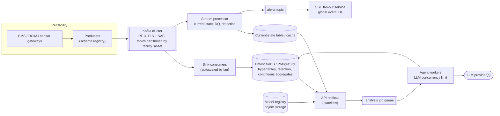

# Production readiness: reliability, security, evaluation, scaling, performance, gaps

Current behaviour is described as implemented, with file references. Recommendations are labelled
**Recommended** or **Proposal**. Nothing here has been deployed beyond a developer laptop.

## Contents

1. [Reliability, security and observability](#1-reliability-security-and-observability)
2. [Testing and evaluation](#2-testing-and-evaluation)
3. [Deployment and scaling](#3-deployment-and-scaling)
4. [Performance and cost engineering](#4-performance-and-cost-engineering)
5. [Prioritized gap analysis](#5-prioritized-gap-analysis)

---

## 1. Reliability, security and observability

### 1.1 Implemented protections

| Concern | Implementation | Location |
|---|---|---|
| Input validation | Pydantic `CustomModel(extra="forbid")`; ID regexes; `UtcDatetime` rejects naive datetimes; bounded lists, strings and ranges; metric allowlist | `app/common/schemas/base.py`, each `schemas.py` |
| Validation errors | Rendered without echoing input | `app/exceptions.py: _validation_error` |
| Authentication | Opt-in `API_AUTH_TOKEN`, bearer, `secrets.compare_digest` | `app/common/security/auth.py` |
| Authorization | `AssetScope` from `API_ALLOWED_ASSETS`: 403 for explicit out-of-scope requests, silent filtering for lists, `RESTRICTED` in the twin, SSE filtering, copilot tools scoped | `auth.py`, `assets/scope.py`, `copilot/tools.py`, `digital_twin/stream.py` |
| Least privilege on reads | Read-only connections for dashboard/assets/twin/copilot | `database.get_read_session`, `sqlite_store.py`, `postgres_store.py` |
| SQL injection | Bound parameters only; identifiers from constants | `storage/base.py` |
| Secrets | `.env` gitignored; `SecretStr`; redacted URLs; keys never logged or returned | `config.py`, `streaming/settings.py: redact_url`, `recommendations/llm.py` |
| Timeouts | PG connect 3 s (API); statement timeout 10 s (`API_QUERY_TIMEOUT_S`); SQLite busy 5 s; LLM 60 s | `database.py`, stores, `LLMSettings` |
| Retries | Consumer: bounded exponential backoff with jitter; LLM: 1 transport + 1 parse retry; explanation: 1 re-ask; agents: ≤ 1 re-analysis | `consumer.py`, `llm.py`, `graph.py` |
| Idempotency | `event_id` dedup with conflict detection; deterministic recommendation and alert IDs + unique constraints | `storage/base.py`, `recommendations/graph.py` |
| Transactions | One per consumer batch; one per analysis (analysis + recommendations + alerts); one per decision | `persist_batch`, `save_analysis`, `add_decision` |
| Offsets | Committed only after DB commit and DLQ confirmation, contiguous prefix only | `consumer.py: OffsetTracker` |
| Dead letters | Every unprocessable message kept with reason and original bytes | `dead_letter.py` |
| Logging | JSON lines (timestamp, level, component, message, context) to stderr and `logs/phase1.jsonl` | `logging_utils.py` |
| Request IDs | Accept or generate; echoed in `X-Request-ID` and every error body; in the access log | `middleware.py` |
| Agent traces | Per-node status, latency, model, tokens, errors; persisted for analyses | `recommendations/graph.py` |
| Health | `/api/v1/health` (store + schema version) | `api/v1/router.py` |
| Security headers | nosniff, DENY framing, no-referrer, CORP, strict CSP + no-store on API paths | `common/security/headers.py` |
| Config safety | Invalid estimator config stops startup; `recommendation_only` cannot be disabled; unset limits disable rules | `cooling/config.py`, `cooling_model/config.py` |
| Bounded resources | Threadpool 40; SSE subscribers 50, queues 100, replay 500; copilot memory 200×10, 1 h TTL; response points 5,000; range 24 h | `config.py`, `stream.py`, `memory.py` |

### 1.2 Incident behaviour

**Telemetry store unavailable**
- API startup still succeeds. Every DB-backed request returns `503 database_unavailable` (or
  `store_not_initialized`) with a request ID; `/health` returns 503. Errors are logged with the target
  (credentials redacted) and the error type only.
- `POST /recommendations/generate` checks the store before running the graph, so no LLM tokens are spent
  on an analysis that cannot be persisted.
- The SSE stream stays open and sends `resync_required`.
- The consumer retries `CONSUMER_MAX_RETRIES` times with backoff, then exits 1 **without** committing
  offsets. After a restart it resumes exactly there; idempotent writes absorb redelivery. Measured earlier:
  a 5.2 s PostgreSQL restart was absorbed by 2 retries ([PIPELINE_GUIDE §II.14](PIPELINE_GUIDE.md#ii14-troubleshooting)).

**Model provider (Fireworks) unavailable**
- Recommendations: the planner falls back to running all agents; each failing specialist is `FAILED`, its
  types become `INCONCLUSIVE`; the explanation falls back to the template; status
  `COMPLETED_WITH_FALLBACK`. Worst-case latency is bounded by timeouts × attempts (no global deadline).
- Copilot: deterministic interpretation and summary with a warning.
- Operators can force deterministic mode with `AGENTS_LLM_ENABLED=false` (restart required).

**Prediction service (model) unavailable or invalid**
- Legacy routes: `503 model_not_trained` / `model_artifact_invalid`. `/cooling/*`: `200` with
  `status: UNAVAILABLE` and reason codes.
- Recommendations run without a forecast: forecast evidence is `unavailable`, `PREEMPTIVE_COOLING` becomes
  `INCONCLUSIVE` ("inlet forecast (…)" missing).
- A corrupt artifact is detected at load (missing files, wrong XGBoost major version, feature-count
  mismatch) and never served.

**Stale telemetry**
- Two clocks: `DQ_STALE_ASSET` (event time, per asset, > `stale_after_seconds`) and `DQ_PIPELINE_STALE`
  (wall clock, nothing ingested for > `max_ingest_age_seconds`).
- Effects: the dashboard and asset detail add warnings; the twin shows `STALE`, `thermal_status: UNKNOWN`
  and excludes stale servers from aggregates; forecasts are `DEGRADED`; live recommendation analyses make
  every type except `SENSOR_DATA_QUALITY` `INCONCLUSIVE`. For a historical `as_of`, wall-clock staleness is
  only a warning.

### 1.3 Recommended hardening (not implemented)

| Area | Recommendation |
|---|---|
| Identity | OIDC/JWT per user; roles (viewer, operator, reviewer, admin); bind `reviewer` and copilot conversations to the authenticated subject; tenant/facility claims instead of `API_ALLOWED_ASSETS` |
| SSE auth | Short-lived signed stream tokens in the query string, or cookie auth with CSRF protection |
| CORS | Allow POST for the frontend origin only |
| Secrets | Secret manager (Vault, cloud KMS); key rotation; separate keys per environment |
| Rate limiting | Per user and per route, especially `/recommendations/generate` and `/copilot/chat`; a global LLM concurrency limit |
| Deadlines | Request-level deadline for agent runs; cancel LLM calls when the client disconnects |
| Metrics | Prometheus: request latency histograms per route, error rates by code, consumer lag, batch sizes, DLQ rate, LLM calls/tokens/latency/fallbacks per node, SSE subscribers and drops, model `UNAVAILABLE` reasons |
| Tracing | OpenTelemetry spans for request → graph node → LLM call → DB query, with `request_id` and `analysis_id` |
| Logs | Rotation and a central sink; today `logs/phase1.jsonl` grows without limit and is shared by all processes and tests |
| Readiness | Separate liveness/readiness; readiness includes model load status and (optionally) provider reachability |
| Retention | Delete or archive exported `telemetry_readings` older than N days; retention for analyses, alerts and logs; a data-classification policy |
| Audit | Immutable audit log for decisions and configuration changes (who changed which limit, when) |

---

## 2. Testing and evaluation

### 2.1 What exists

`uv run pytest` (default `-m 'not integration'`), measured during this pass: **451 passed, 13 skipped, 2
deselected** in 66 s. The skips are PostgreSQL-marked tests without `TELEMETRY_TEST_POSTGRES_URL` and one
real-pandas check; the deselected tests are the 2 Kafka integration tests.

| Level | What it covers | How |
|---|---|---|
| Unit | Event building and validation, simulator determinism, store idempotency/conflicts/export recovery, DuckDB queries, estimator metrics and every rule, feature leakage, split/purge, validity in both directions, artifacts and corruption, optimizer selection and bounds, recommendation rules and validator, copilot parsing, layout validation, SSE diff/replay/overflow | Plain pytest with fixtures written through the real store |
| API | Every route's success and error cases, auth and scope, read-only connections, statement timeouts, cursors, model unavailability, lifecycle, HTTP hardening | `httpx.AsyncClient` + `ASGITransport` with the real lifespan (`tests/conftest.py`) |
| PostgreSQL | Store tests again on PostgreSQL in a throwaway schema | `-m postgres` + `TELEMETRY_TEST_POSTGRES_URL` |
| Integration | Real broker: produce → consume → SQLite + DLQ + Parquet → DuckDB, restart, full replay | `-m integration` + `docker compose up -d kafka` |
| LLM paths | Scripted outputs: valid, wrong citations, hallucinated numbers, execution claims, provider errors | `tests/recommendation_helpers.ScriptedLLM` (no network) |

Not run in this pass: the PostgreSQL and Kafka integration suites. No end-to-end browser test exists (no
frontend), and there is no CI.

**Interpreting results.** "Skipped" is not "passed": PostgreSQL behaviour is unverified unless `-m postgres`
ran. Unit tests verify the guards and the logic on controlled fixtures, not model or agent *quality* on real
data.

### 2.2 Evaluation status by dimension

| Dimension | Status | Experiment needed |
|---|---|---|
| Forecast quality | **Measured** offline on simulated data (RMSE skill −4.0 % / −1.4 %) | Same pipeline on real telemetry; rolling-origin backtests; per-asset and per-regime skill; calibration once intervals exist |
| Baseline comparison | **Measured** vs persistence | Add seasonal-naive and linear AR baselines |
| Recommendation validity | Not measured | Golden scenarios with known ground truth (injected anomalies, fixtures with physics); precision/recall of `REQUIRES_REVIEW` per type; operator review of a blinded sample |
| Thermal constraint violations | Not measured (no control exists) | In shadow mode: count windows where an accepted recommendation's predicted path would cross T_safe vs what was observed |
| Energy savings | **Cannot be measured**: no cooling power | Metered cooling power + controlled A/B or switchback experiments with workload and weather adjustment |
| Agent correctness | Guards tested, quality not measured | Rates of rejection, conflicts, fallbacks and citation errors per 100 live calls; agreement with rule outcomes; adversarial copilot prompts |
| Latency and cost | Single-request observations only | Load test (e.g. k6/Locust) per route; p50/p95/p99; tokens and cost per analysis from traces |
| Telemetry freshness | Detected per request | Metric: ingest age and event-time lag per asset, alerting on SLO breach |
| Digital twin consistency | Unit-tested (diff, scope, replay) | Contract tests that `/overlays`, `/state` and `/assets/{id}` agree at the same `observed_at`; SSE soak test with reconnects |

---

## 3. Deployment and scaling

### 3.1 Current deployment

- `docker-compose.yml`: Kafka 3.9.1 (KRaft, single broker, replication factor 1, PLAINTEXT, bound to
  127.0.0.1:9092) and optional PostgreSQL 16 (profile `postgres`, 127.0.0.1:55432, named volume).
- Producer, consumer and API run on the host with `uv run`. There is no Dockerfile for them, no CI/CD,
  no Kubernetes/Terraform, and no TLS.
- **Single-process assumptions:** SSE broadcaster, event IDs and replay buffer; copilot memory; the
  training lock; the loaded model. Running `uvicorn --workers N` today would give N independent pollers,
  ID sequences and memories. SQLite allows one writer, so the consumer and recommendation writes contend.

### 3.2 Production proposal

| Concern | Trade-off and proposal |
|---|---|
| Containerization | One image for API/consumer/workers with different entry points; pin the XGBoost version (artifacts check the major version) |
| Horizontal API scaling | Make the API stateless first: move conversation memory and SSE events to a shared store or bus; load the model from a registry |
| Database | TimescaleDB hypertables on `event_timestamp`, partitioned by facility; composite index `(facility, simulation/source, asset, time)`; continuous aggregates for 1m/5m/1h buckets; retention policies |
| Streaming connections | A dedicated SSE/WebSocket fan-out tier subscribed to a state-change topic; clients subscribe per room/zone |
| Caching | Current state per asset (written by the stream processor) instead of recomputing `latest_observed` per request; layout as a static, versioned asset |
| Background jobs | `POST /recommendations/generate` → 202 + job ID; workers with retries and idempotency on `(run, asset, window_end)`; the existing `GET /analyses/{id}` becomes the status endpoint |
| Model inference | XGBoost on CPU is microseconds per row; load once per worker; batch predictions for overlays. GPU inference adds nothing at this model size |
| LLM rate limits | Token-bucket per provider; queue with backpressure; cache analyses per `(asset, window_end, evidence hash)`; deterministic mode as a degradation level |
| Backpressure | Kafka absorbs ingest bursts; consumer lag drives autoscaling; the API sheds load with 429 before threadpool exhaustion |
| Multi-tenancy | Facility/tenant ID in every key, topic partition and row; tenant-scoped tokens; row-level security in PostgreSQL |
| HA / DR | Kafka RF 3 across zones; PostgreSQL primary + replica with PITR; topic retention long enough to rebuild the store; the store is rebuildable from Kafka + Parquet within retention |

### 3.3 From one facility to hundreds, and to higher-frequency telemetry

Back-of-envelope sizing (an assumption, not measured): 100 facilities × 10,000 sensorized assets × 1 event/min
= 1M events/min ≈ 16,700 events/s ≈ 60M events/hour. At ~1.7 KB of JSON per event that is ~28 MB/s
uncompressed. Changes needed:

- **Contract:** facility and real asset IDs replace `simulation_run_id` scoping; Avro/Protobuf with a schema
  registry instead of JSON Schema files; compression (lz4/zstd, already configurable).
- **Partitioning:** Kafka keys `facility:asset`; hundreds of partitions; consumer groups per sink.
- **Storage:** typed columns + hypertables; 1-minute rollups; raw retention days to weeks; Parquet/object
  storage for long-term history.
- **Current state:** maintained by a stream processor, not by per-request aggregates.
- **Sub-second telemetry:** aggregate at the edge or in the stream (e.g. 10 s windows) before the API;
  features and rules must become windowed stream computations; the twin pushes deltas at a fixed UI rate
  (e.g. 1 Hz), not per event.
- **Agents:** never per event. They are triggered by detected incidents or by humans, with deduplication
  per incident.

---

## 4. Performance and cost engineering

### 4.1 Observations (not benchmarks)

Single requests against the local SQLite store (46,539 readings, 48 asset rows across 8 runs), Windows
laptop, during this documentation pass: health 14 ms; cooling state (one asset) 33 ms; legacy forecast
27 ms; `/cooling/predict` 11 ms; dashboard overview 147 ms; twin state 120 ms; twin overlays 112 ms; copilot
(deterministic, all-asset trend question) 190 ms; first `/assets` call after startup 962 ms (cold).
Earlier live LLM runs: planner 1–5 s, specialists 8–18 s each, one 181 s re-analysis.

### 4.2 Bottlenecks visible in the code

| Hot spot | Where | Why it matters | Fix | How to verify |
|---|---|---|---|---|
| N+1 decisions | `RecommendationService.list` → `_review_status` per row | 50 rows = 51 queries | `LEFT JOIN LATERAL` / window function for the latest decision, or a `review_status` column updated on decision | Query count per request; p95 of `GET /recommendations` at 200 items |
| Per-asset estimator reads | `CoolingStateEstimator.evaluate` → `readings_window` per asset | Data-center snapshots issue one query per asset (20 here; 10,000 at scale) | One windowed query for all assets of the run, grouped in Python, or SQL-side aggregates | Query count and latency vs asset count |
| Sequential forecasts | `TwinService.overlays("predicted_temperature")` | One read + feature build + predict per server | Batch: one query for all lookback windows, one `DMatrix` for all rows | Overlay latency vs asset count |
| Index order | `idx_readings_asset_time (asset_id, event_timestamp)` | Run filter applied after the index range; grows with every run | `(simulation_run_id, asset_id, event_timestamp)` (or facility-scoped in production) | `EXPLAIN` before/after; latency with 100 runs loaded |
| `latest_observed` | `MAX(event_timestamp)` group-by + self-join per request | Cost scales with the run's rows | Current-state table, or a partial index on observed rows | Same |
| SSE snapshot | `snapshot_fn` recomputes all states + 200 alerts + 200 recs every 10 s | O(assets) per poll even when nothing changed | Change-data-driven updates (consumer publishes state changes) | DB time per poll; CPU at idle |
| Sync LLM requests | `/recommendations/generate` holds a threadpool token for the whole run | 40 concurrent analyses exhaust the pool for all routes | Job queue + workers; separate pool | Saturation test: latency of `/health` while N analyses run |
| Prompt size | Evidence lists sent whole (copilot capped at 120 items) | Tokens and latency grow with evidence | Send summaries plus IDs; cap per agent; drop `unavailable` items for agents that cannot use them | Tokens per call from traces |
| Repeated agent work | Same asset/window analysed repeatedly | Dedup prevents duplicate rows, not duplicate LLM calls | Short-circuit when a completed analysis for the same `(run, asset, window_end)` exists | Cache hit rate; cost per day |
| Frontend 3D | — (not built) | Draw calls dominate | `InstancedMesh`, LOD ([DIGITAL_TWIN §6](DIGITAL_TWIN.md#6-scaling-to-large-facilities)) | Frame time p95 |
| Memory | Training loads every selected series into NumPy; each booster file is ~160–190 KB | Fine at this size | Stream features per run for large data | Peak RSS during training |

Tail latency today is dominated by LLM calls (seconds to minutes) and by cold starts. Agent selection
(the planner, and specialists only where needed), bounded retries and the deterministic mode are the cost
levers in code. None of the proposed improvements has been measured.

---

## 5. Prioritized gap analysis

Priority: **P0** = correctness or safety, would make results misleading; **P1** = reliability and security
before any shared deployment; **P2** = observability and performance; **P3** = maintainability.

| # | Gap | Evidence in the repository | Risk | Recommended fix | Validation | Priority |
|---|---|---|---|---|---|---|
| 1 | All telemetry is synthetic | `source_type: simulated` everywhere; dataset self-described as engineered | Any quantitative claim is about the simulator | Integrate a real source (BMS/DCIM) behind the same event contract | Re-run evaluation on real data; compare distributions | P0 |
| 2 | No measured cooling power | `UNAVAILABLE_MEASUREMENTS`; `measured_cooling_power_column: null` | Energy savings cannot be computed; IT power could be misused | Meter fans/CRAH/chillers; add fields in schema v2.0 | Energy-response model validated on held-out periods | P0 |
| 3 | No causal fan→inlet response | `validity.py` result 0/35; simulator has no such dependency | Unsafe counterfactual recommendations if the guard were bypassed | Controlled, approved step tests; intervention-validated model | Validity check passes on held-out assets; predicted vs observed step responses | P0 |
| 4 | Safety limits unset | `t_safe_c`, bounds, most estimator limits `null` | Rules not evaluated → `PARTIALLY_ASSESSED`; optimizer blocked | Site-verified values with change control | Config review sign-off; tests per limit | P0 |
| 5 | Forecaster has no skill and no uncertainty | RMSE skill −4.0 % / −1.4 %; RMSE-only "uncertainty" | Predictions add no information; overconfident consumers | Calibrated intervals; better features on real data; report skill prominently (already done) | Coverage of intervals; rolling skill > 0 | P0 |
| 6 | Evaluation design caveats | Shared event-time split puts short runs in train only; `per_asset_mae` groups by `asset_id` across runs | Test results cover only evening hours of two seeds; per-asset counts misleading | Per-run chronological split or held-out seed; group by `(run, asset)` | Re-run evaluation; compare | P1 |
| 7 | No anomaly detector; alerts only on analysis | `anomaly_records` = injected labels; `alert_rows` called in `persist_recommendation` | Incidents are missed unless someone asks | Detector consumer group (robust z-scores per asset/metric) writing alerts | Precision/recall vs injected labels | P1 |
| 8 | Authentication is a single shared token; reviewer self-declared | `auth.py`; `DecisionRequest.reviewer` | No accountability; any token holder can record approvals as anyone | OIDC + roles; bind reviewer to the token subject | AuthZ tests per role; audit log review | P1 |
| 9 | Single-process state | `TwinBroadcaster`, `ConversationStore`, train lock in memory | Cannot scale out; IDs reset on restart | Shared bus/store; global event IDs | Multi-replica soak test with reconnects | P1 |
| 10 | Synchronous agent runs, no deadline | `RecommendationEngine.analyze` inside the request | Thread starvation; client timeouts; unbounded worst case | Job queue, deadline, cancellation | Saturation test | P1 |
| 11 | No rate limiting or LLM budget | No limiter in `app/` | Cost and provider quota exhaustion | Per-user/route limits; global LLM concurrency | Load test with limits | P1 |
| 12 | Twin analyze topology-word defect | `understanding.py` `TOPOLOGY_WORDS` check | Rack/room analysis fails for natural questions | Skip the topology clarification when asset IDs were resolved by the caller | API test: "Why is this rack warm?" on `rack-21` | P1 |
| 13 | CORS allows GET only | `middleware.py` | A browser frontend cannot call POST routes | Allow POST for configured origins | Browser preflight test | P1 |
| 14 | No CI, no container image for the app | No `.github/`, no Dockerfile | Regressions unnoticed; non-reproducible deploys | CI running `uv run pytest` (+ PostgreSQL and Kafka services); Dockerfile | Green pipeline on every PR | P1 |
| 15 | No retention | No pruning of `telemetry_readings`, analyses, logs | Unbounded growth; slower queries | Retention for exported rows; log rotation | Table size over a week of streaming | P2 |
| 16 | No metrics or tracing | Logs only | Slow detection of lag, errors, LLM fallbacks | Prometheus + OpenTelemetry (§1.3) | Dashboards and alerts on SLOs | P2 |
| 17 | Query hot spots | §4.2 | Latency grows with assets and runs | Index, batching, current-state table | `EXPLAIN`, load tests | P2 |
| 18 | Copilot citations not verified; keyword parser | `check_numbers` ignores `[E…]`; keyword lists | Wrong citations unnoticed; paraphrases misread | Verify cited IDs exist; evaluate the parser on a question set | Citation-error rate; intent accuracy | P2 |
| 19 | SQLite single-writer contention | Consumer and API both write | `database is locked` after 5 s | PostgreSQL for any shared run | Concurrency test with streaming + analyses | P2 |
| 20 | Two forecast API generations | `/cooling-model/predict` (503) and `/cooling/predict` (status) | Client confusion | Deprecate one with a sunset date | API changelog | P3 |
| 21 | No migration framework | Version table + idempotent DDL | Risky schema changes | Alembic or sqitch-style migrations | Upgrade/downgrade tests | P3 |
| 22 | `pipeline` ignores CLI flags | `pipeline.py: main()` takes no arguments; `--help` runs the pipeline | Surprise side effects | argparse with `--help` | CLI test | P3 |
